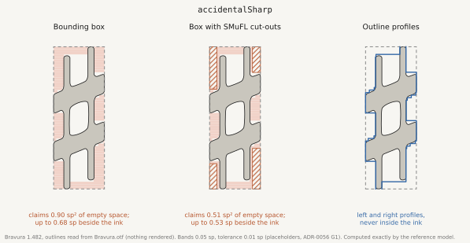
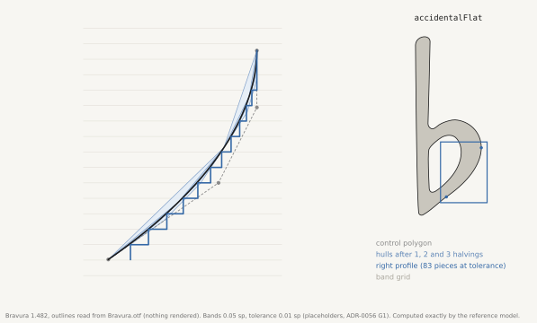
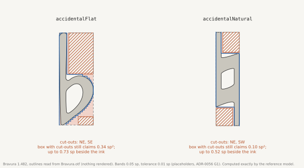
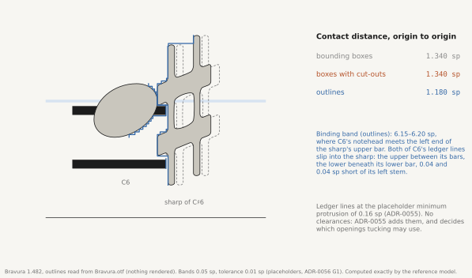
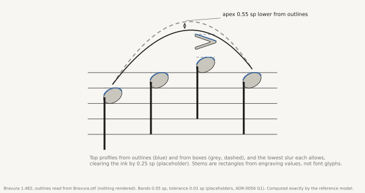

# ADR-0056: Glyph Geometry from Outlines

## Status

Accepted

The decision is made: layout reads glyph geometry from the fonts’ outlines, through profiles computed once per font file and frozen as data. The band grid, the tolerance, the library that reads outlines and three narrower questions are open items, G1 to G6, settled during implementation and [ADR-0055](0055-Horizontal-Spacing.md#the-exploration)’s exploration.

## Table of Contents

- [Context](#context)
- [Decision](#decision)
  - [Outlines, Read and Never Rendered](#outlines-read-and-never-rendered)
  - [Four Profiles per Glyph](#four-profiles-per-glyph)
  - [A Profile Never Understates Ink](#a-profile-never-understates-ink)
  - [Frozen as Data](#frozen-as-data)
  - [Geometry Not from Fonts](#geometry-not-from-fonts)
  - [Transformations](#transformations)
  - [SMuFL Cut-Outs](#smufl-cut-outs)
  - [Where Two Glyphs Meet](#where-two-glyphs-meet)
  - [What This ADR Does Not Decide](#what-this-adr-does-not-decide)
- [Invariants and Property Tests](#invariants-and-property-tests)
- [Alternatives Considered](#alternatives-considered)
- [Consequences](#consequences)
- [Open Items](#open-items)
- [References](#references)

## Context

Spacing has to know where each glyph’s ink is. [ADR-0055](0055-Horizontal-Spacing.md) builds every atom’s contours from its glyphs’ profiles: for each band of height, the leftmost and the rightmost ink. Stage 5 needs the same in the other axis, for slurs, articulations, dynamics and the distances between staves and systems ([ADR-0013](0013-Slur-Formatting.md), [ADR-0028](0028-Hierarchical-Rendering-Pipeline.md)). This ADR decides where those profiles come from.

Three sources are available, and two fall short:

- **Bounding boxes** overstate the blocking width wherever a glyph’s corner is empty, and each overstatement makes a gap prestretched that need not be ([ADR-0055](0055-Horizontal-Spacing.md#atoms-and-contours)).
- **Bounding boxes refined by SMuFL’s cut-outs**, the `cutOutNE`, `cutOutSE`, `cutOutSW` and `cutOutNW` anchors that mark rectangular regions at a box’s corners that hold no ink, remove some of that overstatement but not all of it:
  - Cut-outs are rectangles at corners. Ink anywhere else is still the box: a sharp’s narrow stems above and below its bars, the space between its bars, a flat’s bowl beyond its corners, a natural’s offset stems.
  - Cut-outs exist only where a font’s designer supplied them. In Bravura, 165 glyphs carry them; other fonts carry fewer or none.
  - Text fonts, for lyrics, expressions, tempo marks and text fingerings, carry no SMuFL metadata at all.
  - They say little about the vertical axis.
- **The glyphs’ outlines** answer all four. They are in every font file, for every glyph, in both axes, and they are the ink itself. LilyPond builds its skylines from them: `lily/stencil-integral.cc` reads a glyph’s FreeType outline and adds its Bézier curves to the skyline in short segments, with a quantisation unit of 0.2.

Three requirements of other ADRs constrain how outlines may be used:

- **Determinism.** The same music gives the same page on every machine and after any history of edits ([ADR-0037](0037-Measure-Distribution-Optimization.md#layout-is-a-function-of-the-piece)).
- **Exactness.** Layout arithmetic is exact and rational ([ADR-0037](0037-Measure-Distribution-Optimization.md)).
- **Stability.** A piece is rendered only with the exact font versions it records, because a font and its layout are a tested pair ([ADR-0047](0047-Font-Management.md#piece-font-manifest-and-version-matching)). Nothing else may change a piece’s layout silently either.

## Decision

Every glyph’s geometry for layout comes from its outline in the font file, through profiles computed once per font file, bounded so that they never understate ink, and frozen as data that layout only reads. [ADR-0055](0055-Horizontal-Spacing.md) builds its contours from these profiles.

### Outlines, Read and Never Rendered

Outlines are read as the font stores them. TrueType outlines are quadratic Bézier curves with integer coordinates; CFF outlines are cubic Bézier curves whose coordinates are integers or 16.16 fixed-point numbers. Both are exact rationals in font units.

No rasteriser, hinting or renderer takes part. No rendering library, version or setting can therefore change a profile, and the backend needs no renderer ([ADR-0038](0038-Backend-Authoritative-Rendering-and-Terminal-Frontend-Execution.md)).

Font units convert to staff spaces through the font’s units per em and SMuFL’s convention that a five-line staff is one em high, so one staff space is a quarter of an em. The conversion is an exact rational factor.

### Four Profiles per Glyph

Each glyph has four profiles, relative to the glyph’s origin as SMuFL places it:

| Profile | For each band of | Gives | Read by |
| --- | --- | --- | --- |
| Left | height | the leftmost ink | Stage 1: ADR-0055’s contours |
| Right | height | the rightmost ink | Stage 1: ADR-0055’s contours |
| Bottom | width | the lowest ink | Stage 5: vertical placement |
| Top | width | the highest ink | Stage 5: vertical placement |

A profile is a step function with rational breakpoints and rational values, in staff spaces. Counters, the holes inside a glyph, never affect a profile: a band’s outermost ink always lies on the outline.

*Figure 1. Bravura’s sharp as a box, as a box with cut-outs, and as its outline’s profiles. The box claims 0.90 sp² of empty space; with its cut-outs it still claims 0.51 sp², up to 0.53 sp beside the ink. The outline’s profiles stay within 0.01 sp of it.*

### A Profile Never Understates Ink

A profile is a bound on the ink, not an estimate of it. In every band it lies at least as far out as the outline’s extreme there, and at most the tolerance beyond the ink in that band or within the tolerance of its edges. It is computed exactly:

1. Each curve segment is subdivided by de Casteljau’s construction at t = ½. Midpoint subdivision keeps every coordinate rational, with a power of two in its denominator, so no rounding occurs.
2. A Bézier segment lies within the convex hull of its control points. The extreme of a piece’s control points within a band therefore bounds the curve’s extreme there, from outside.
3. Subdivision continues until each piece’s control points lie within the tolerance of its chord in the profile’s axis, or until the piece lies within one band.
4. Straight segments are taken exactly.

Bands lie on a fixed grid in staff spaces (G1). Adjacent bands are merged when their values differ by less than the tolerance, keeping the outer value, so merging never moves a profile inward.

*Figure 2. One curve of Bravura’s flat bowl, its control polygon, the hulls after one, two and three halvings, and the right profile that results: 83 pieces at the 0.01 sp tolerance, never inside the curve.*

### Frozen as Data

Profiles are computed once, when a font is registered ([ADR-0047](0047-Font-Management.md#metadata-loading)), and stored with its per-font metadata. They are keyed by the font file’s content hash and by the version of the algorithm that extracted them. Layout reads them and never computes them.

- A change of platform, library or renderer cannot move a note.
- A different font file has a different hash and its own profiles. The piece font manifest records each font’s version and content hash, and refuses to render a piece with a font file it does not record ([ADR-0047](0047-Font-Management.md#piece-font-manifest-and-version-matching)), so a piece is always laid out with the profiles of the fonts it records.
- An improvement to the extraction algorithm increments its version. That is a deliberate, announced layout change, never a side effect. Whether pieces record the version they were laid out with is G2.

### Geometry Not from Fonts

Stems, ledger lines, staff lines, beams and barlines are drawn from engraving values, which are piece settings ([ADR-0047](0047-Font-Management.md)). Their profiles are computed exactly from those shapes, rectangles and parallelograms, not read from a font.

Text is shaped first, with the text font’s kerning and ligatures. A shaped run’s profile is the union of its positioned glyphs’ profiles (G5).

### Transformations

- **Scaling** (reduced staves, cue sizes, rastral steps) scales a profile by an exact rational factor.
- **Mirroring** swaps the left and right profiles, or the top and bottom.
- **Quarter-turn rotations** exchange the horizontal and vertical profiles.
- **Any other transformation**, such as an arbitrary rotation or a shear, computes profiles from the transformed outline when the transformation is first used, and caches them under the glyph, the transformation and the font’s hash (G3).

### SMuFL Cut-Outs

Cut-outs are not a source of any geometry. They are kept for two purposes:

- **A cross-check.** At registration, each cut-out region is tested against the glyph’s outline. Ink found inside a declared cut-out is reported as an error in the metadata or in the outline, never silently corrected.
- **A statement of intent.** A cut-out says the font’s designer meant that corner to be open. Whether spacing honours that intent beyond what the outline shows is [ADR-0055](0055-Horizontal-Spacing.md)’s question (G6).

*Figure 3. Bravura’s flat and natural with their cut-outs. The box with cut-outs still claims 0.34 sp² of empty space around the flat, up to 0.73 sp beside its bowl, and 0.10 sp² around the natural.*

### Where Two Glyphs Meet

The nearest two glyphs can come horizontally is found band by band. Where the right profile of the glyph on the left and the left profile of the glyph on the right share a band of height, the difference between them is how far apart their origins must be in that band; the largest such difference over all shared bands is their contact distance. [ADR-0055](0055-Horizontal-Spacing.md) adds the clearance for the pair of glyph classes that meet and builds blocking widths from it. Vertical contact, used by Stage 5, is the same computation with the bottom and top profiles across bands of width.

*Figure 4. C6 and the sharp of C♯6. The contact distance, origin to origin, is 1.340 sp from boxes, 1.340 sp from boxes with cut-outs and 1.180 sp from outlines. From outlines, C6’s notehead meets the left end of the sharp’s upper bar, and both of C6’s ledger lines slip into the sharp, 0.04 sp short of its left stem. How much of that tucking an engraver would use is set by [ADR-0055](0055-Horizontal-Spacing.md#opening-width)’s opening width.*

*Figure 5. Top profiles from outlines and from boxes over a bar of one staff, and the lowest slur each allows at a placeholder clearance of 0.25 sp. The slur from outlines has its apex 0.55 sp lower.*

### What This ADR Does Not Decide

How spacing uses the geometry is [ADR-0055](0055-Horizontal-Spacing.md)’s to decide. In particular, which openings may be used for tucking is ADR-0055’s [opening width](0055-Horizontal-Spacing.md#opening-width): Stage 1 fills every opening narrower than it as it builds contours from these profiles, so tucking uses only the openings an engraver would. The cached profiles are pure geometry that depends only on the font, so no change of house style ever invalidates them.

## Invariants and Property Tests

Each invariant is a property test over every glyph of every bundled font, and over generated outlines.

1. **Never inside the ink.** Points sampled on every curve at rational parameters, evaluated exactly, lie within the glyph’s profiles in their bands.
2. **Close to the ink.** In every band, a profile lies within the tolerance of the farthest sampled point in that band, the band widened by the tolerance at each edge: a piece that straddles a band’s edge may carry ink from just across it.
3. **Determinism.** The same font file gives identical profiles, compared exactly, on every platform and in every run.
4. **Keyed use.** No profile is ever read for a font whose content hash, or for an algorithm version, other than the one it was computed with.
5. **Within the box.** A glyph’s profiles lie within its SMuFL bounding box, widened by the tolerance; a glyph whose outline leaves its declared box is reported.
6. **Cut-outs checked.** Ink inside a declared cut-out is reported at registration, with the glyph and the cut-out named; nothing is changed.
7. **Layout never computes.** No formatting stage reads an outline; a test that removes outline access after registration leaves every layout unchanged.
8. **Exact transformations.** Scaling a profile by a rational factor equals computing it from the outline scaled by the same factor, within the tolerance scaled likewise; a mirrored glyph’s profiles are its original’s, exchanged.

The figures above are generated from Bravura’s outlines by the same algorithm, so they double as worked examples of these properties.

## Alternatives Considered

| Alternative | Why not |
| --- | --- |
| Bounding boxes refined by SMuFL cut-outs | Rectangles at corners only; depends on each font’s metadata; nothing for text fonts; little for the vertical axis. |
| Rasterised bitmaps | Depend on the rasteriser, its version and its settings (anti-aliasing, hinting); quantisation must be rounded outward everywhere; need a renderer on the backend. Stable only if frozen, and then no better than outlines while less exact. |
| Outlines read at layout time, without a cache | Repeats work at every formatting; makes layout depend on the outline reader at run time; gives a library upgrade the power to move notes. |
| Hand-tuned tables per glyph, such as LilyPond’s ledger-shortening ranges | Special cases per glyph and per font; what the outline already states, restated by hand. |

Reading outlines and freezing their profiles keeps what each alternative had to offer, LilyPond’s real shapes and a cache’s speed, without their dependencies.

## Consequences

### Positive

- **Contours follow the ink.** Gaps are not prestretched for corners no reader sees, and accidentals, flags and displaced noteheads tuck as far as their real shapes allow.
- **Any font, any glyph.** Fonts without cut-outs, and text fonts for lyrics and expressions, are spaced by their actual shapes.
- **Both axes from one source.** Stage 5’s vertical placement reads the same frozen geometry as Stage 1’s contours.
- **Deterministic and stable.** Profiles change only with the font file or the algorithm’s version, both explicit events.
- **Cheap at layout time.** Formatting reads step functions; the cost of reading outlines is paid once per font, at registration.
- **Font metadata becomes checkable.** Errors in bounding boxes and cut-outs are found and reported.

### Negative

- **Registration does more work.** A SMuFL font has a few thousand glyphs; reading them and storing four profiles each is a one-off cost per font file.
- **The algorithm’s version is part of layout.** Improving it changes pages and must be announced as such.
- **Contour figures in [ADR-0055](0055-Horizontal-Spacing.md#minimum-protrusion) change.** Its worked numbers, such as the 2.796 and 3.036 staff spaces of a sharp’s gap, are computed from boxes with cut-outs, as it notes. Bravura’s real sharp is narrower in places, so the amounts shift; the behaviour does not.
- **More room to tuck is not better engraving.** Finer contours let a program tuck further than an engraver would. Restraint comes from [ADR-0055](0055-Horizontal-Spacing.md)’s clearances and its [opening width](0055-Horizontal-Spacing.md#opening-width), not from coarser geometry.

## Open Items

| Item | Question | Settled by |
| --- | --- | --- |
| G1: Band grid and tolerance | The band height and the tolerance, in staff spaces. Placeholders until measured; LilyPond’s quantisation unit of 0.2 is a reference point, not a value. | Implementation, against [ADR-0055](0055-Horizontal-Spacing.md#the-exploration)’s exploration |
| G2: Pinning the algorithm’s version | Whether a piece records the profile algorithm’s version it was laid out with, as the piece font manifest records font versions, or whether a new version is treated as a release-level layout change. | Decision before the first change of version |
| G3: Other transformations | Which transformations beyond scaling, mirroring and quarter-turns occur in practice, and whether caching their profiles per glyph is enough. | When a formatter first needs one |
| G4: The outline reader | Which library reads outlines on the JVM: one that reads the font’s own tables directly, so coordinates arrive as the font stores them, is preferred over one that passes through a renderer’s scaler. The choice must preserve exact coordinates. | Implementation |
| G5: Text runs | How shaping, kerning and ligatures of text fonts are represented, so that a run’s profile is the union of what is drawn. | The lyrics and text ADRs |
| G6: Cut-outs as intent | Whether spacing ever honours a declared cut-out as the designer’s intent, beyond what the outline shows, or uses cut-outs only as a cross-check. | [ADR-0055](0055-Horizontal-Spacing.md#the-exploration)’s exploration |

## References

### Related ADRs

- [ADR-0055: Horizontal Spacing](0055-Horizontal-Spacing.md) — builds atoms’ contours from the left and right profiles; owns the opening width, the clearances and their glyph classes
- [ADR-0047: Font Management](0047-Font-Management.md) — registers fonts, loads their metadata and stores the profiles with it; the piece font manifest pins font versions
- [ADR-0048: SMuFL Glyph Selection Architecture](0048-SMuFL-Glyph-Selection-Architecture.md) — decides which glyph is drawn, and so whose profiles are read
- [ADR-0028: Hierarchical Rendering Pipeline](0028-Hierarchical-Rendering-Pipeline.md) — contours replace its four-directional extents; Stage 5 reads the vertical profiles
- [ADR-0013: Slur Formatting](0013-Slur-Formatting.md) — Stage 5’s vertical placement against the top and bottom profiles
- [ADR-0037: Measure Distribution Optimization](0037-Measure-Distribution-Optimization.md) — exact rational arithmetic and the layout as a function of the piece
- [ADR-0038: Backend-Authoritative Rendering and Terminal Frontend Execution](0038-Backend-Authoritative-Rendering-and-Terminal-Frontend-Execution.md) — layout on the backend, with no renderer needed for geometry
- [ADR-0006: SMuFL](0006-SMuFL.md) — the font standard, its staff-space convention and its cut-out anchors

### External References

- [SMuFL Specification](https://www.w3.org/2021/03/smufl14/index.html) — the staff-space convention and the cut-out anchors
- [SMuFL metadata specification](https://www.w3.org/2021/03/smufl14/specification/font-specific-metadata.html) — bounding boxes and anchors, including `cutOutNE`, `cutOutSE`, `cutOutSW` and `cutOutNW`
- [Bravura](https://github.com/steinbergmedia/bravura) — the font whose outlines the figures are drawn from
- [LilyPond](https://gitlab.com/lilypond/lilypond) — `lily/stencil-integral.cc` and `lily/open-type-font.cc`, skylines built from glyph outlines
