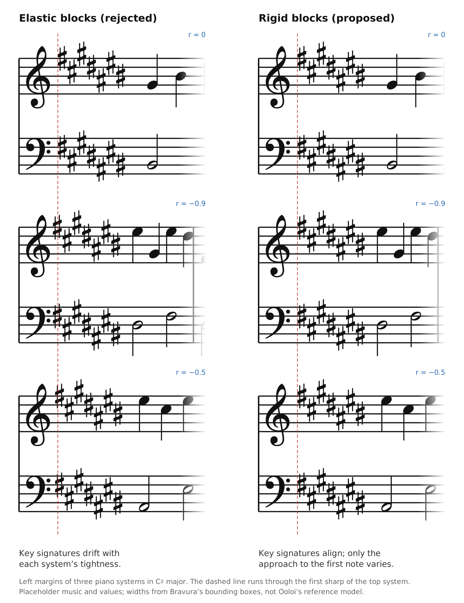
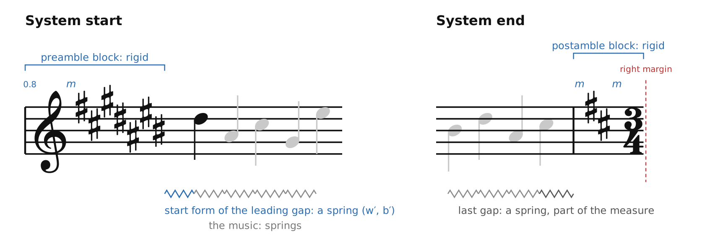
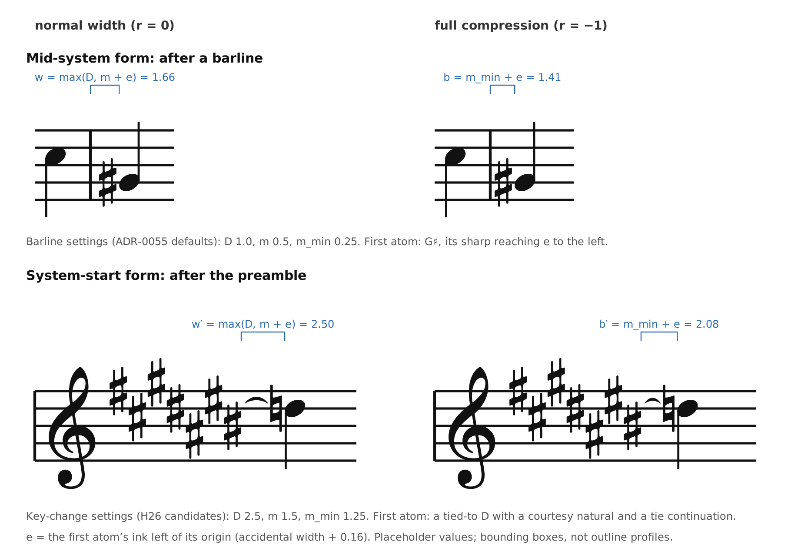
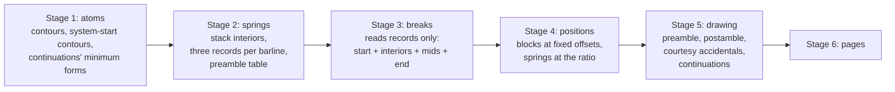

# ADR-0058: Variants at a Break

## Status

Accepted

The decision is made: the material that differs where a system starts or ends, or exists only mid-system, is specified here as one decision, between [ADR-0055](0055-Horizontal-Spacing.md), whose Stages 1 and 2 produce it, and [ADR-0037](0037-Measure-Distribution-Optimization.md), whose Stage 3 reads it:

- **Every barline is a discretionary break**, in TeX's sense. It carries three records: what it adds when no break falls there, when a system ends there, and when a system starts there. Each stack carries one more, its interior, the same in every layout. Stage 3 reads these records and nothing else.
- **Prefatory blocks are rigid.** The preamble comes from one table for the piece, keyed by the clefs and keys in force, so identical preambles align down the page by construction.
- **There is no gutter and no separate no-break width.** Material at a break goes where it is anchored: to a barline's records or to the first note.
- **The approach from the preamble to the first note is a spring**: the system-start form of the stack's leading gap, measured from the preamble's right edge as from a wall.

[ADR-0055 H10](0055-Horizontal-Spacing.md#h10-no-break-material-and-the-system-start) is settled here. Values and several policies are open items V1 to V12, settled by the exploration, on the workbench and against the plates, and by the validation. The rules are tried on the workbench before they are built ([The Exploration](#the-exploration)).

## Table of Contents

- [Context](#context)
  - [What Varies at a Break](#what-varies-at-a-break)
  - [Two Kinds of Space](#two-kinds-of-space)
  - [The Page](#the-page)
  - [LilyPond](#lilypond)
- [Decision](#decision)
  - [Every Barline Is a Discretionary Break](#every-barline-is-a-discretionary-break)
  - [Where Each Kind of Material Goes](#where-each-kind-of-material-goes)
  - [The Blocks Are Rigid](#the-blocks-are-rigid)
  - [The Preamble Table](#the-preamble-table)
  - [Material Goes Where It Is Anchored](#material-goes-where-it-is-anchored)
  - [The Approach to the Music Is a Spring](#the-approach-to-the-music-is-a-spring)
  - [Rows of Items Are Rigid Wherever They Stand](#rows-of-items-are-rigid-wherever-they-stand)
  - [Where the Records Are Computed](#where-the-records-are-computed)
  - [What Stage 3 Receives](#what-stage-3-receives)
  - [Where Breaks May Fall](#where-breaks-may-fall)
  - [Stages 4 and 5](#stages-4-and-5)
  - [Settings](#settings)
  - [Break Forms of Constraints Across a Barline](#break-forms-of-constraints-across-a-barline)
- [The Exploration](#the-exploration)
- [Invariants and Property Tests](#invariants-and-property-tests)
- [Alternatives Considered](#alternatives-considered)
- [Consequences](#consequences)
  - [Positive](#positive)
  - [Negative](#negative)
- [Open Items](#open-items)
- [References](#references)

## Context

### What Varies at a Break

Material at a barline has up to three forms, as a discretionary break in TeX has: what stands mid-system, what ends a system there, and what starts the next ([ADR-0055](0055-Horizontal-Spacing.md#the-bar-boundary)). Everything else at a barline belongs to a measure in every form. What varies:

- **The preamble**: the clef and key signature in force on every staff, at each system start.
- **System-start material**: courtesy accidentals for tied-to notes at position 0, tie continuations, and a start repeat that a break moves to the system's start.
- **The postamble**: cautionary key and time signatures after a system's last barline, for a change taking effect at the start of the next system.
- **No-break material**: the start part of a repeat barline mid-system, and cancellation naturals where house style omits them at a system start.
- **Break forms of constraints across a barline**: a split tie, a glissando or hairpin continuing across the break, a hyphen at a system's end, a syllable overhanging a system's start ([ADR-0055 H12](0055-Horizontal-Spacing.md#h12-elements-that-reserve-room)), reduced conservatively ([ADR-0037](0037-Measure-Distribution-Optimization.md#constraints-spanning-several-columns)).

### Two Kinds of Space

A system start holds two kinds of space: the space inside the prefatory block (from the clef to the key signature), and the approach from the block to the first note. A system end holds one: the space inside the postamble block (from the barline to the cautionary key, and from the key to the time signature).

### The Page

The two kinds behave differently on a page.

- **Preambles form a column.** Each system's preamble stands directly below the one above, and is often identical on every system of a piece. The eye reads them as a column down the left margin, part of the page's frame. A preamble compressed differently on a tight system would misalign identical glyphs from system to system, which reads as an error.
- **The approach to the first note has no such neighbour.** What follows it differs from system to system, so small variations break no visible alignment.
- **Cautionaries are occasional.** They appear only where a change takes effect, so nothing down the page lines up with them. They stand after the last barline at the right margin, where crowding the barline makes a cautionary read as part of the bar.



*The left margins of three piano systems in C♯ major, at adjustment ratios 0, −0.9 and −0.5. Left, elastic blocks, the rejected alternative: the clef-to-key distance shrinks with the system, and the key signatures drift off the dashed line through the top system's first sharp. Right, rigid blocks: the key signatures align down the page, and only the approach to the first note varies. A mock-up, not computed by the reference model: Bravura's glyphs drawn from the font's outlines and placed by their bounding boxes; the music and the values (an elastic clef-to-key minimum of 0.2) are placeholders.*

### LilyPond

LilyPond's source takes the same view:

- **Rigid blocks.** `Break_alignment_interface::calc_positioning_done` (`lily/break-alignment-interface.cc`) places a breakable column's clef, key signature and time signature at fixed offsets from their `space-alist` entries (`scm/define-grobs.scm`): clef to key signature 0.82, key to time signature 1.15, barline to key signature 1.0 and to time signature 0.75. Items ending a line are aligned to the right edge the same way (`right-edge`, 0.5).
- **An elastic approach, per item.** `Staff_spacing::get_spacing` (`lily/staff-spacing.cc`) makes the space from the last prefatory item to the first note a spring, from that item's `first-note` entry at a line start. After a key signature it is `shrink-space` 2.5 (shrinks fully, never stretches); after a time signature `semi-shrink-space` 2.0 (half fixed); after a clef alone `minimum-fixed-space` 5.0 (rigid). Compression stops at least 0.3 staff spaces beyond the skyline minimum.

LilyPond re-solves the spacing for every candidate line, with the start and end forms of each column swapped in (`lily/simple-spacer.cc`). This ADR gets the same layout from numbers known before breaking.

## Decision

Every barline is a discretionary break with three records, and every stack has an interior. Prefatory blocks are rigid, and the preamble comes from a table. Material at a break goes where it is anchored. The approach from a system's preamble to its first note is a spring. Stage 2 computes all of it, and Stage 3 reads the records.



*A system start and a system end. The preamble and postamble blocks are rigid: their distances (`m`, and 0.8 from the system's left edge to the clef) are fixed at every ratio. The approach from the preamble to the first note is the start form of the leading gap, a spring; so are the gaps of the music, and the measure's last gap before its barline. A mock-up, not computed by the reference model: Bravura's glyphs drawn from the font's outlines and placed by their bounding boxes; values are placeholders.*

### Every Barline Is a Discretionary Break

Number the stacks `0` to `N − 1`, and let barline `k` be the one before stack `k`: barline `0` is the piece's start and barline `N` its end. Knuth and Plass give every possible break three forms of material, for no break, before the break and after it. Here each barline carries one record for each:

- **`mid[k]`**, used when no break falls at barline `k`: stack `k`'s leading gap in its mid-system form, including any key or time change before its first note, and the material only a barline inside a system has (the start part of a repeat; cancellation naturals where house style omits them at a system start).
- **`end[k]`**, used when a system ends at barline `k`: the postamble block, and the end corrections of [Break Forms](#break-forms-of-constraints-across-a-barline).
- **`start[k]`**, used when a system starts at barline `k`: the preamble block, the row that follows it (a time signature taking effect there, a start repeat moved there by the break), stack `k`'s leading gap in its system-start form, and the start corrections.

Each stack `i` carries **`interior[i]`**: everything from its first column to its closing barline, which by ADR-0055 it owns in the form the barline takes at a system's end. The interior is the same in every layout, which is what makes the partition work: everything that differs between a break and no break lies between a barline and the first column after it, and belongs to that barline's records. Barline `0` has only a start record, and barline `N` only an end record, which is empty. A clef change taking effect at stack `k` stays where ADR-0055 puts it, before barline `k` in `interior[k − 1]`, which is also its cautionary form at a system's end; the new clef reaches `start[k]` through the table. A key or time change taking effect there appears in all three records, in three forms: after the barline in `mid[k]`, as a cautionary in `end[k]`, and in the block or row of `start[k]`.

A system of stacks `s` to `t − 1` then takes

```
start[s]  +  Σ interior[i]  +  Σ mid[k]  +  end[t]
             s ≤ i < t         s < k < t
```

Each record is a few numbers: fixed width (rigid blocks, rows and fixed space), the minimum, natural and ordinary ideal sums of its springs, and its prestretched pairs. The formula is the whole contract between Stage 2 and Stage 3.

**Grouping is not ownership.** A stack's leading gap is computed from its own measure, by the same rules and in the same stage as the measure's other gaps; it is grouped with the barline before it because that is where its two forms differ. An override of a measure's widths reaches its leading gap, since Stage 2 applies overrides before it groups ([ADR-0055](0055-Horizontal-Spacing.md#user-inputs)).

### Where Each Kind of Material Goes

| Material | Where it goes |
| --- | --- |
| Clef and key signature at a system start | A rigid block from the preamble table, keyed by the clefs and keys in force, in `start[k]`; it ends at its ink |
| A time signature at a system start where the meter changes | The measure's change, in the rigid row after the block, in `start[k]` |
| A start repeat moved to a system start by a break | The rigid row after the key and time signatures, in `start[k]` |
| A courtesy accidental on a tied-to note at a system start | The first atom's system-start contour: ink before its origin, inside the start form, moving with its note |
| A tie continuation at a system start | A constraint from the wall to the tied-to atom, at its minimum length, inside the start form; Stage 5 draws it into the room the spring gives |
| A glissando end at a system start | As a tie continuation, from the wall to the glissando's target atom |
| A hairpin, trill or octave line, or lyric extender continuing into a system | A start correction in `start[k]` (V5); the conservative reduction until then |
| The space from the preamble to the first note | The leading gap's system-start form, in `start[k]`: a spring measured from the wall |
| The leading gap mid-system, with any key or time change before the first note | `mid[k]` |
| The start part of a repeat mid-system; cancellation naturals omitted at a system start | `mid[k]`: what it holds that `start[k]` and `end[k]` lack |
| Cautionary key and time signatures at a system end | A rigid postamble block in `end[k]` |
| A tie, glissando or hairpin starting, or a hyphen, at a system end | End corrections in `end[k]` (V5); the conservative reduction until then |
| A measure's closing barline and the gap before it | The stack's interior |
| What Stage 3 receives | Each stack's interior and each barline's three records |

### The Blocks Are Rigid

- **The preamble block.** On each staff, the clef and key signature in force, at the columns of a small raster shared by the system's staves: a clef column at the system's left edge and a key-signature column. Each distance between consecutive items is the earlier item's least distance at normal width, `m`, measured to the next item's ink on the outline profiles ([ADR-0056](0056-Glyph-Geometry-from-Outlines.md)). That is the value [ADR-0055 H26](0055-Horizontal-Spacing.md#h26-changes-before-a-note) already uses for items in a row, here fixed at every ratio, and the largest across the staves. The standard distance `D` is an item's distance to a note, so it governs the start form, not the block.
- **The row after it** holds what `start[k]` adds before the first note: a time signature taking effect at stack `k`, then a start repeat that a break moves to the system's start, each at the previous item's least distance at normal width. It is as rigid as the block.
- **The row ends at its ink.** It carries no space after its last item; the leading gap's start form supplies it, so that space is counted once.
- **Its right edge is a wall.** On each staff, the row's last ink is a vertical edge that guards every height, as a barline does. Nothing tucks under a key signature, so a courtesy accidental can never read as part of one, and the start form depends only on the kind of the row's last item, not on its glyphs.
- **The postamble block.** After the system's last barline: the cautionary key signature, with any cancellation naturals the change requires, and the cautionary time signature, separated by the barline's and the key signature's least distances at normal width, fixed at every ratio. It is `end[k]`'s fixed width, for the changes taking effect at stack `k`; zero where none does, at the end of the piece, and when system-end cautionaries are suppressed.
- **Material only a barline inside a system has**, the start part of a repeat and cancellation naturals if house style omits them at a system start (V4), is fixed width in `mid[k]`, so it counts exactly where no break falls.
- **The distance from the system's left edge to the clef** is fixed space inside the block. A first-system indent and instrument names stay outside it, part of the system-width policy ([ADR-0037](0037-Measure-Distribution-Optimization.md#variable-system-widths)).

### The Preamble Table

- **One table for the piece**, keyed by the clef and key signature in force on every staff: musical state, known before breaking. Stage 2 builds it from the clefs and keys in force at each measure.
- **Each entry** holds the block's width, its glyphs' positions for Stages 4 and 5, and its paintlist.
- **Each barline holds an index**: the entry for the clefs and keys in force at stack `k`. Stage 2 adds the entry's width to `start[k]`'s fixed width, so Stage 3 never consults the table; Stages 4 and 5 use the index to place and draw the block.
- **The table is keyed by font and settings too**: the font file's content hash, as ADR-0056's profiles are, and the settings that govern the blocks' distances. An edit that changes a clef or key changes the indices of the barlines it governs, and adds an entry if the combination is new.
- **Identical blocks hold by construction.** Every system with the same clefs and keys uses the same entry, laid out from the system's left edge, so the preambles align down the page because the data structure allows nothing else. What the row adds after the block follows it without moving it.
- **Every barline needs its index, because breaking is global.** The breaker finds the best layout by evaluating every barline as a possible system start, so it needs a start record for every one. Only a greedy breaker knows its system starts in advance. The table is the structural sharing, made explicit: a piece has a handful of combinations, however many staves and measures it has.

### Material Goes Where It Is Anchored

Material at a system start is anchored at one of two ends. The test is whether a thing moves with the left margin or with the first note:

- **A start repeat moved by a break** stands at a fixed distance after the key signature and moves with the left margin. It joins the rigid row in `start[k]`.
- **A courtesy accidental** belongs to its note. It stands a fixed small distance before the notehead and moves with it. It joins the first atom's system-start contour.
- **A tie continuation or glissando end** runs from the row into the first note, so its length is whatever lies between them. It becomes a constraint inside the start form.

There is therefore no separate area for system-start decorations, no gutter, and no separate no-break width: what only a barline inside a system has is part of `mid[k]`. Stage 3 knows, before breaking, exactly what every system start needs, and Stage 5 draws into room already reserved.

### The Approach to the Music Is a Spring

- **Two forms of one gap.** Stack `k`'s leading gap has a mid-system form, in `mid[k]`, from the previous barline ([ADR-0055](0055-Horizontal-Spacing.md#the-space-around-a-barline)), and a system-start form, in `start[k]`, from the wall to the first column. Stage 2 computes both from Stage 1 geometry computed once. This is one gap with two forms, not the second layout of a measure that [ADR-0028](0028-Hierarchical-Rendering-Pipeline.md#alternative-3-dual-computation-two-complete-measure-layouts) rejects (Alternative 3).
- **Measured per staff.** In each staff the start form runs from that staff's wall to its own first atom. Its ideal and blocking widths are each the largest across the staves.
- **Its settings** are those of the kind of the row's last item: a key change after a key signature, a time change after a time signature, a clef after a clef alone, a barline after a start repeat. The widths follow ADR-0055's formula after a barline, with that kind's `D`, `m` and `m_min`, and `e` the reach of the first atom's ink left of its origin (V1 asks whether a set of its own is better).
- **The first atom's system-start contour.** Stage 1 supplies, for every atom that can stand first in a system, the contour it has there: courtesy accidentals for tied-to notes, as ink before its origin. They are graphical, not semantic ([ADR-0035](0035-Remembered-Alterations.md)), and always reserved, whatever the courtesy setting: whether a system starts a page is decided in Stage 6, after Stage 3.
- **Continuations ending at the first atom**, a tie continuation or a glissando end, are constraints from the wall to that atom. Each needs its minimum length plus its clearances (V11), and enters the start form's blocking width. Stage 5 draws it into the room the spring gives, as it widens a ledger line into the room its minimum form reserved ([ADR-0055](0055-Horizontal-Spacing.md#atoms-and-contours)). Where a requirement exceeds the ideal width, the gap is prestretched and enters Stage 3 as a kink, as any prestretched gap does. Continuations ending further into the system are break forms ([Break Forms of Constraints Across a Barline](#break-forms-of-constraints-across-a-barline)).
- **Elasticity** is ADR-0037's baseline: shrink `max(0, w′ − b′)`, priced stretch `σ × w′`. In Stage 4 its stretch weight is `k_D × D` of its kind, as after a barline, so after a key or time signature (`k_D` = 0) it does not stretch. After a clef alone, V2 decides.
- **The start form may be wider or narrower than the mid-system form**, in ideal and in blocking width: no barline's least distance applies at a system start, and the kinds' settings differ. The records hold each form whole, so nothing in Stage 3 depends on which is wider.



*The leading gap's two forms, at normal width (left) and at full compression (right). Above, mid-system, after a barline, with ADR-0055's default barline settings: the first atom is a G♯ whose sharp reaches `e` to the left. Below, at a system start, measured from the wall at the end of a C♯ major preamble, with H26's candidate key-change settings: the first atom is a tied-to D with a courtesy natural, and the tie continuation ends short of it. `w = max(D, m + e)` and `b = m_min + e`, with `e` the accidental's width plus 0.16. A mock-up, not computed by the reference model: Bravura's glyphs drawn from the font's outlines and placed by their bounding boxes; values are placeholders.*

### Rows of Items Are Rigid Wherever They Stand

Consecutive prefatory items (clef, key signature, time signature, a repeat barline) form a rigid block wherever they stand, and only the block's distance to the following note is a spring. The distances inside a block are typographic, not rhythmic; compressing them gains little and misaligns blocks that repeat.

At a break this ADR decides it. Mid-system, the same principle settles the "Items in a row" question of [ADR-0055 H26](0055-Horizontal-Spacing.md#h26-changes-before-a-note), so that a key signature spaces alike at a system start and after a barline mid-system: in `mid[k]` the row after the barline is rigid, and only its distance to the first note is a spring.

**After a barline**, a key or time change is therefore not ink attached to the note that follows it. Its distance to that note is the spring, with the settings of the change's kind, measured from the change's ink as the start form is measured from the wall; it is not a minimum form that Stage 5 widens. At normal width the change stands at its standard distance from its note, which settles H26's "After a barline" as well. Whether the row's last item guards every height, as the wall at a system start does, remains H26's "Changes as walls".

**Within a measure** the distances inside a row are rigid too, each the earlier item's least distance at normal width. The row as a whole stays ink before the column that follows it, as [ADR-0055](0055-Horizontal-Spacing.md#the-space-around-a-barline) decides for a single change: it sits in the previous note's white where it fits, and enters the springs only through the blocking width of the gap before its note, so duration space never depends on it. How such a row's distance to its note compresses, and how a row too wide for the previous note's white widens the gap, are open (V12).

### Where the Records Are Computed

Stage 1 supplies the first atoms' system-start contours and the continuations' minimum forms. Stage 2 computes everything else, and Stage 3 performs no engraving work:

- the preamble table, and for each barline the index of its entry;
- for each stack, its interior;
- for each barline, its three records, with the table entry's width already in `start[k]`.

Stage 2 applies user overrides and barline drags before it groups springs into records, and a setting that changes any record is read in Stage 2, where it can move notes and system breaks ([ADR-0055](0055-Horizontal-Spacing.md#spacing-settings)).



*What each stage produces and reads at a break. Stage 3 reads records only.*

### What Stage 3 Receives

```clojure
{:stacks   [{:interior record} ...]                         ;; stacks 0 … N−1
 :barlines [{:mid record :end record :start record} ...]}   ;; barlines 0 … N: barline k stands before stack k
;; barline 0 has only :start, barline N only :end

;; a record: what its material adds to a system
{:fixed ratio                                     ;; rigid blocks, rows, fixed space
 :min ratio :natural ratio :ordinary-ideal ratio  ;; sums over its springs
 :prestretched [[w b] ...]}                       ;; its prestretched pairs, the kinks
```

Every interior has a positive ideal width, its `:ordinary-ideal` and the ideal widths of its prestretched pairs together, so that every segment can stretch, as [ADR-0037](0037-Measure-Distribution-Optimization.md#interface-contract) requires of every stack.

For a candidate system `[s, t)`, and each quantity `X` of a record (`:fixed`, `:min`, `:natural`, `:ordinary-ideal`):

```
X(s,t)         = start[s].X + Σ_{s≤i<t} interior[i].X + Σ_{s<k<t} mid[k].X + end[t].X
available(s,t) = system_width − fixed(s,t)
```

- **Feasibility** is `min(s,t) ≤ available(s,t)`, necessary and sufficient as before, since every shrink is its own room above its minimum.
- **Solving for `r`** is ADR-0037's: one division when shrinking, the fast path when stretching up to the first kink. The segment's kinks are its records' prestretched pairs; the first is the least of two range minima, over the interiors and the mids, and two lookups, `start[s]` and `end[t]`.
- **Exactness.** Every term comes from `start[s]`, `end[t]` or a sum over the segment, so each system's cost depends on the segment alone and the DP stays exact.

**Stage 3 derives its sums itself**, once, in O(N). With `u[i] = interior[i] + mid[i]` (and `mid[0]` empty), `U` its prefix sums, and `δ[s] = start[s] − mid[s]`:

```
X(s,t) = U[t].X − U[s].X + δ[s].X + end[t].X
```

That is O(1) per candidate. The difference `δ` is Stage 3's private arithmetic, not part of the contract.

**Early termination.** For a fixed end `t`, the DP tries starts `s` leftward and stops once no earlier start can be feasible. The bound counts only the records a system starting at `s` certainly uses inside it:

```
bound(s,t) = Σ_{s≤i<t} (interior[i].fixed + interior[i].min) + Σ_{s<k<t} (mid[k].fixed + mid[k].min)
stop when bound(s,t) > system_width
```

Moving `s` one stack left adds `interior[s − 1]` and `mid[s]`, both non-negative, so the bound never decreases. It leaves out `start[s]` and `end[t]`, which are non-negative too, so it never exceeds the true requirement, `fixed(s,t) + min(s,t)`; it therefore never prunes a feasible segment. ADR-0037's assumption on `system-width-fn` applies. The subtle case of a start form narrower than its mid-system form needs no special handling, because the bound never counts `mid[s]`, a record a system starting at `s` does not use. The reference check under Invariant 5 confirms both claims, and shows that counting `mid[s]` can prune the optimum.

### Where Breaks May Fall

A break at barline `k` uses `end[k]` and `start[k]`; no break uses `mid[k]`. Forbidding a break at a barline (a group of measures kept together, a frozen system's interior) only removes it from the DP's candidates, and forcing one only forbids `mid[k]`; neither changes a record. A group may still be folded into one stack for speed: its interior is its members' interiors and the mids of the barlines inside it, and its records are those of the barlines at its ends.

### Stages 4 and 5

- **Stage 4** reads which record each barline's material takes from the breaks: `mid[k]` inside a system, `end[k]` and `start[k]` at a break. It places each block and row at its fixed offsets, from the table entry for a preamble, and every spring at the system's ratio under compression, or through its stretch weight under stretching.
- **Stage 5** draws the preamble, the postamble, courtesy accidentals and continuations at those positions, among the left margins [ADR-0028](0028-Hierarchical-Rendering-Pipeline.md) assigns it. Each continuation fills the room the spring gave it, never less than its minimum form. The courtesy-accidental setting (`:system`, `:page`, `:none`) affects Stage 5 only.

### Settings

- **Distances inside the blocks and rows** are the kinds' least distances at normal width, `m` (clef, key, time, barline), house-style values applied alike to every system. They are read in Stage 2. There is no setting that compresses a block. Whether one value per kind suffices, or rows need distances per pair of items, is V8.
- **The start form** takes the settings of the kind of the row's last item (V1). Its least distance from the wall to an accidental is V10.
- **Continuations at a system start** need minimum lengths, ADR-0055's minimum tie length or values of their own (V11).
- **Suppressing system-end cautionaries** empties `end[k]`'s postamble. It is read in Stage 2, and has no page-dependent option, which is why the postamble may depend on it while the start form's courtesy reservations may not.

### Break Forms of Constraints Across a Barline

Continuations that end at the first atom, tie continuations and glissando ends, are decided above: they enter the start form. For the others, the baseline stays ADR-0037's conservative reduction at a break. As an extension (V5), the break form of such a constraint enters as a correction in a record:

- **a start correction** in `start[k]`, for a continuation ending further into the system: a hairpin, a trill or octave line, a lyric extender, a syllable overhanging the system's start;
- **an end correction** in `end[k]`, for a piece ending the system there: a tie or glissando starting there, a hairpin, a hyphen at the system's end.

A correction can be negative, where the conservative reduction reserved more than the break form needs. The bound then subtracts constants: `end[t]`'s own negative part, and the most negative start correction in the piece; both keep it monotone. A constraint spanning several barlines, cut at two of them, gives a correction depending on both ends of the middle system: segment-local, so still exact, at a small cost per candidate.

## The Exploration

These rules are tried on the workbench, [ADR-0057](0057-Reference-Model-of-the-Spacing-Pipeline.md#the-exploration)'s interactive model, before any of them is built, as ADR-0057 requires of every spacing rule. Its reference implementation computes this ADR's figures; the three here are mock-ups, placed by bounding boxes with placeholder values, and are to be replaced by the model's.

- **A page view.** The central claim, that rigid blocks look right and elastic ones would not, can only be judged across systems. The workbench needs a view of several systems stacked as on a page, each at its own adjustment ratio or width. It needs no breaker: each system is an independent one-system model, built from a start record, interiors and mids, and an end record.
- **A temporary switch between rigid and elastic blocks**, kept only while the eye compares, as the rhythmic-order checkbox was. The comparison across stacked systems at different ratios is the evidence for the rejection under [Alternatives Considered](#alternatives-considered); once it is made, the switch goes.
- **A second temporary switch**, between the elastic start form and one in which the courtesy material keeps fixed room, as a gutter would ([Alternatives Considered](#alternatives-considered)), to judge under compression whether the room before the first note should yield.
- **Live settings for the open items**: the start form's settings (V1), the approach after a clef alone (V2), when the start form yields (V3), the distances inside the blocks (V8), the wall's least distance to an accidental (V10) and the continuations' minimum lengths (V11).
- **The postamble at the right margin**, seen as the rest of its system is compressed and stretched.
- **Ravel's *Ondine* as the first test case** (*Gaspard de la nuit*, 1908), with its opening and climax measures. The piece is in C♯ major, so each piano system carries seven sharps, the widest standard key signature, under a treble and a bass clef: the largest preamble blocks the raster will meet. The first system adds the time signature, testing the rigid-row rule on the full row of clef, key and time, while later systems in the same key show clef and key alone, so a page view tests identical preambles down the page. The figuration is dense from the first bar, so the start form is tested under pressure directly after the widest preamble. The score is in the public domain, which matters because whatever the interactive model contains is published (ADR-0057).
- **Further presets**: a transposing score with key signatures of different lengths, a clef alone at a system start, a cautionary key and time signature at a system end, a start repeat moved to a system start, a tied note with a courtesy accidental there, and a glissando across a break.

What the workbench settles by eye is then checked against the plates (V9).

## Invariants and Property Tests

Each is a property test over generated pieces, as ADR-0055's are.

1. **Identical combinations, identical blocks.** On every system with the same clef and key on every staff, and the same settings, every preamble glyph stands at the same distance from the system's left edge, at every ratio. Every postamble glyph stands at the same distance from its barline, for the same changes. The table makes this hold by construction; the test checks the construction.
2. **Every index is right.** Each barline's index names the entry for the clefs and keys in force at the stack after it.
3. **The records partition the material.** For any choice of breaks, the width Stage 4 lays out for a system equals the sum of its records at that system's ratio, and each piece of material is counted by exactly the records whose form shows it. In particular no interior differs between layouts.
4. **Blocks and rows do not depend on the ratio.** Changing a system's adjustment ratio moves no glyph inside a preamble, a row or a postamble relative to its block.
5. **Early termination is exact.** The pruned DP and an unpruned DP return identical breaks, ratios and tie-breaks, over generated pieces that include start forms narrower and wider than their mid-system forms. A reference check, `adr-0058-exactness-check.py`, builds random pieces as interiors and barline records, and compares the DP with brute-force enumeration of every segmentation, in exact rational arithmetic. It agrees on every one of its 3,000 random pieces, and a targeted search finds a piece on which a bound that counts `mid[s]` prunes the optimum.
6. **Variants reach Stage 3 as numbers only.** Stage 3 never queries ChangeSets, measures a glyph or reads the table; a test that removes that access from Stage 3 leaves every layout unchanged.
7. **No collision at any feasible ratio** ([ADR-0055](0055-Horizontal-Spacing.md#invariants-and-property-tests) Invariant 1) covers block and row ink, the walls and the start form, within each staff and across the shared columns.
8. **The barline guards the postamble.** At every ratio, no postamble ink stands nearer the system's last barline than the barline's least distance (ADR-0055 Invariant 18).
9. **Continuations keep their minimum.** At every feasible ratio, every tie continuation and glissando end at a system start is drawn at least at its minimum length.
10. **Courtesy reservations hold.** Changing the courtesy-accidental setting changes no record, ratio or system break; only what Stage 5 draws.
11. **Grouping changes no record.** A layout with a group of measures kept together equals the same layout found with breaks forbidden at the group's barlines, folded or not.
12. **The layout is a function of the piece** ([ADR-0037](0037-Measure-Distribution-Optimization.md#layout-is-a-function-of-the-piece)), including after edits that change clefs, key signatures, cautionaries, ties and glissandi across a barline, and the settings this ADR names.

## Alternatives Considered

| Alternative | Why not |
| --- | --- |
| Elastic blocks: springs inside the preamble and postamble, shrinking to their minimum | Identical preambles would be compressed differently on tight systems and misalign down the page. The gain is a fraction of a staff space per system. Compressed cautionaries crowd the barline and read as part of the bar. LilyPond keeps both blocks rigid. Not offered as a setting either: a setting that can misalign preambles is a trap |
| A gutter: a separate area of constant width after the preamble, for system-start decorations | It mixes material anchored at opposite ends: a courtesy accidental belongs to its note, a start repeat to the left margin. As constant width it also adds room at normal width where the approach's standard distance already has it, and a courtesy accidental the setting hides then leaves a visible gap. Complete information before breaking does not need it |
| Preamble and postamble computed in Stage 3, on demand, by querying ChangeSets and measuring glyphs, cached by combination | Engraving work inside Stage 3, against [ADR-0037](0037-Measure-Distribution-Optimization.md#design-principle-no-engraving-rules-after-stage-2)'s design principle that Stages 3 and 4 are mathematics over springs |
| Fields indexed by stack: the leading gap in its stack, the start form as a difference, the postamble attached to the stack after it, a no-break width on the boundary after a stack | The same values under three index conventions, each an off-by-one trap. The barline records state them under one, and Stage 3 derives the differences itself |
| Storing the preamble in every stack | The preamble depends on the clefs and keys in force, not on the stack's content. A table makes identical blocks structural; storage is not the reason, since per-stack copies would share through the same cache |
| Computing the preamble only for the stacks known to start systems | Requires the system starts before breaking, which only a greedy breaker has. The exact DP evaluates every barline as a possible start, so it needs every start record; the table makes that a lookup |
| Minimum forms widened in Stage 5 | No room to borrow. The postamble has no spring beside it, and widening the preamble would take the first note's space |
| A preamble that carries space after its ink | Duplicates the space the leading gap's start form supplies |
| Spacing solved per candidate line (LilyPond) | Exact, but puts a spacing solve inside every candidate evaluation, returning engraving work to breaking |
| Negative widths in running totals ([Crow, 2026](https://basilcrow.com/blog/relaxing-knuths-restrictions/)) | Crow encodes break-dependent widths as negative widths inside running totals, and needs a suffix-minimum floor to prune safely. Here the contract holds each form whole; Stage 3's private difference `δ` is the same device, but its bound needs no floor, because it counts only the records a system certainly uses |
| Specifying the variants within ADR-0037 and ADR-0055 | Splits one decision across two ADRs, so that questions between them, such as how the space at a system start is divided, belong to neither |

## Consequences

### Positive

- **One formula is the whole contract** between Stage 2 and Stage 3, in the form TeX gave discretionary breaks in 1981, under one index convention.
- **One decision in one place.** Everything that varies at a break is specified here.
- **Every piece of material at a break has one home**, matching where it is anchored, with no gutter and no separate no-break width. Glissando ends are specified with tie continuations.
- **Stage 3 does no engraving work.** It reads records as numbers, as ADR-0037's design principle requires; it does not even see the table.
- **Preambles align down the page by construction**, from one table entry per combination.
- **The start form is exact in both directions**, wider or narrower than the mid-system form, and the early-termination bound needs no special case for it.
- **Grouping becomes a constraint** on where breaks may fall, not a merge of data.
- **Exactness and cost hold.** The DP is exact, and each candidate is O(1) on the fast path.

### Negative

- **One more ADR** to keep in step with ADR-0037, ADR-0055 and ADR-0057.
- **Ownership and grouping differ.** A leading gap is owned by its measure but grouped with the barline before it; a reader must keep the two apart, as the "Grouping is not ownership" paragraph does.
- **Stage 1 produces more per measure:** a system-start contour for each first atom, and minimum forms for continuations.
- **Stage 2 produces more per barline:** three records, and the table beside them.

## Open Items

| Item | Question | Settled by |
| --- | --- | --- |
| V1: The start form's settings | The settings of the kind of the row's last item, or a set of their own (from H10) | The exploration |
| V2: The approach after a clef alone | Rigid, as LilyPond's `minimum-fixed-space` 5.0, or compressible; and whether it stretches | The workbench, then the plates |
| V3: When the start form yields | In proportion from the first compression (the baseline), or only under heavy compression; and whether the courtesy material's room should yield at all | The workbench and the validation, with [ADR-0055 H11](0055-Horizontal-Spacing.md#h11-elasticity-by-gap-class)'s shrinking side |
| V4: Cancellation naturals at a system start | Whether house style omits them, putting them in `mid[k]` alone (from H10) | House style |
| V5: Exact break forms of constraints | Whether corrections in the records replace the conservative reduction for continuations not ending at the first atom, and for pieces ending a system (from [H12](0055-Horizontal-Spacing.md#h12-elements-that-reserve-room)) | The validation, on vocal scores with dense lyrics |
| V6: Hidden empty staves | If staves are hidden per system, a system's start and end records depend on the whole segment, not on its barlines alone; exactness holds, but the table, the records' precomputation and the bound must allow for it | Design, with ADR-0037 |
| V7: Grace notes at a system start | How a grace group at position 0 sits within the start form (from [H7](0055-Horizontal-Spacing.md#h7-grace-notes)) | H7 |
| V8: The blocks' distances | Default values of the distances inside blocks and rows (the kinds' least distances, or distances per pair); LilyPond's are references (clef to key 0.82, key to time 1.15, barline to key 1.0, barline to time 0.75) | The workbench, then the plates |
| V9: A check against the plates | That engraved pages keep identical preambles on systems with identical combinations, as Invariant 1 assumes; a plate edition of *Ondine* is the first case to measure | The exploration |
| V10: From the wall to an accidental | Whether the kind's `m_min` keeps a courtesy accidental clear of the key signature, or the wall needs a least distance of its own to accidentals | The workbench, then the plates |
| V11: Continuations' minimum lengths | ADR-0055's minimum tie length for tie continuations and glissando ends at a system start, or values of their own | The workbench, then the plates |
| V12: Rows within a measure | How a rigid row of changes within a measure compresses towards its note, whether as a minimum form like a single change's ([ADR-0055](0055-Horizontal-Spacing.md#the-space-around-a-barline)) or otherwise, and how a row too wide for the previous note's white widens the gap | The workbench, then the plates |

## References

### Related ADRs

- [ADR-0037: Measure Distribution Optimization](0037-Measure-Distribution-Optimization.md): the Stage 3 interface the records enter, the segment sums and early termination
- [ADR-0055: Horizontal Spacing](0055-Horizontal-Spacing.md): the four forms, the bar boundary and the ownership of barlines and leading gaps, the space around a barline, minimum forms, and the Stage 1 and 2 steps that produce the records
- [ADR-0028: Hierarchical Rendering Pipeline](0028-Hierarchical-Rendering-Pipeline.md): the stages, and its rejection of dual computation for system-start elements
- [ADR-0035: Remembered Alterations](0035-Remembered-Alterations.md): why courtesy accidentals at a system start are graphical, not semantic
- [ADR-0056: Glyph Geometry from Outlines](0056-Glyph-Geometry-from-Outlines.md): the profiles every block distance and blocking width is measured on, keyed by the font file's content hash
- [ADR-0057: Reference Model of the Spacing Pipeline](0057-Reference-Model-of-the-Spacing-Pipeline.md): the one-system model and the workbench that compute the blocks and the start form

### External References

- Knuth, D.E. and Plass, M.F. "Breaking Paragraphs into Lines", *Software—Practice and Experience* 11 (1981), pp. 1119–1184: discretionary breaks with pre-break, post-break and no-break material
- LilyPond source, master branch: [`lily/break-alignment-interface.cc`](https://github.com/lilypond/lilypond/blob/master/lily/break-alignment-interface.cc) (`Break_alignment_interface::calc_positioning_done`), [`lily/staff-spacing.cc`](https://github.com/lilypond/lilypond/blob/master/lily/staff-spacing.cc) (`Staff_spacing::get_spacing`), [`lily/simple-spacer.cc`](https://github.com/lilypond/lilypond/blob/master/lily/simple-spacer.cc) (`maybe_find_prebroken_piece`, end rods), [`scm/define-grobs.scm`](https://github.com/lilypond/lilypond/blob/master/scm/define-grobs.scm) (`space-alist` of `LeftEdge`, `Clef`, `KeySignature`, `TimeSignature`, `BarLine`)
- Crow, B. "Relaxing Knuth's Restrictions: Break-Dependent Widths in Optimal Line Breaking" (6 April 2026), https://basilcrow.com/blog/relaxing-knuths-restrictions/
- Ravel, M. *Gaspard de la nuit*, I. "Ondine" (Durand, 1908): the first workbench test case
- Ross, T. *The Art of Music Engraving and Processing* (1970) and Gould, E. *Behind Bars* (2011): to be consulted for the blocks' distances (V8) and for ties and glissandi across system breaks (V11)
