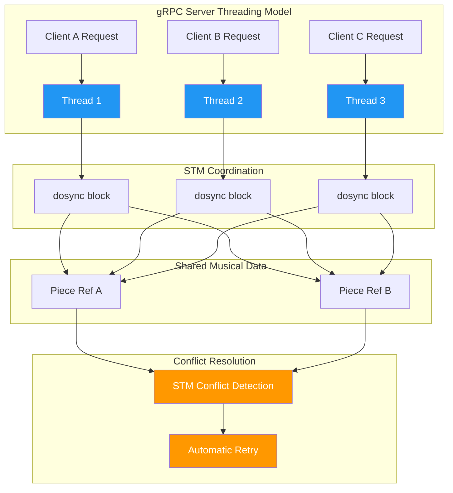
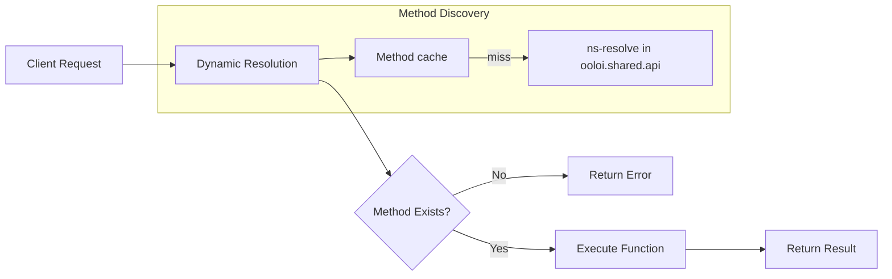
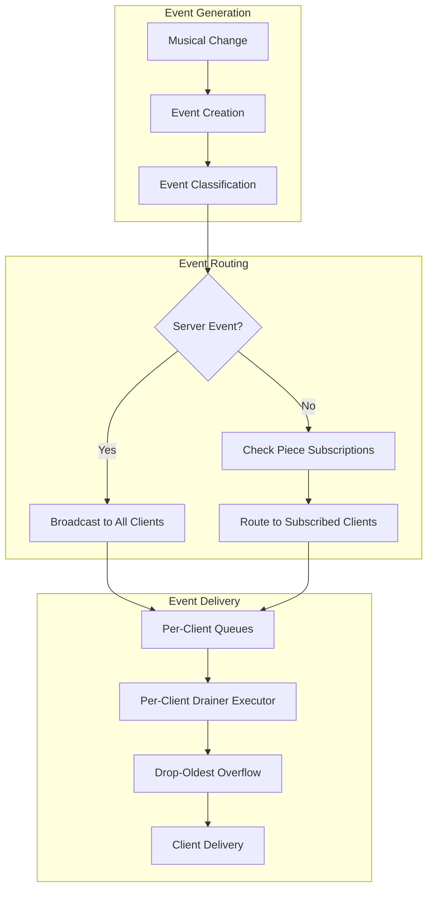

# 🔵 Ooloi Server Architectural Guide: Enterprise-Grade Concurrent Music System

Distributed systems for complex domains like music notation face unique challenges in balancing semantic precision with concurrent access patterns. Ooloi's backend server explores how Clojure's functional programming strengths can combine with gRPC to address these challenges through asynchronous concurrency management.

This comprehensive architectural analysis examines a server design that:
- Handles concurrent access from multiple sources: collaborative users, background threads, file conversion, and automated processes
- Provides ACID transactions within the authoritative server process, atomic across batched operations within a request
- Is shaped for the plugin system specified by [ADR-0003](../ADRs/0003-Plugins.md), under which plugins load without a server restart and run at the same speed as core code
- Preserves perfect type fidelity for complex musical data across network boundaries
- Eliminates traditional protocol buffer complexity through unified message design
- Maintains enterprise reliability through architectural simplicity

Topics covered:
- **Unified Protocol Architecture**: Single message type eliminating traditional gRPC schema complexity
- **STM-gRPC Integration**: Server-local transactions and asynchronous conflict resolution
- **Real-Time Event Streaming**: High-performance hierarchical event delivery for concurrent operations
- **Enterprise Comparison**: Technical analysis comparing Ooloi with traditional enterprise patterns
- **Production Characteristics**: Reliability, scalability, and operational qualities

This guide serves as both architectural documentation and a case study in applying functional programming principles to concurrent distributed system requirements.

## Table of Contents

- [Overview](#overview)
- [Deployment Scenarios](#deployment-scenarios)
- [Core Architecture](#core-architecture)
  - [Unified Protocol Buffer Design](#unified-protocol-buffer-design)
  - [Perfect Type Fidelity](#perfect-type-fidelity)
  - [Software Transactional Memory Integration](#software-transactional-memory-integration)
    - [Performance Characteristics](#performance-characteristics)
  - [Dynamic API Method Resolution](#dynamic-api-method-resolution)
  - [Transactions, Events and Undo at the gRPC Boundary](#transactions-events-and-undo-at-the-grpc-boundary)
- [Real-Time Event Streaming](#real-time-event-streaming)
  - [Two-Tier Event System](#two-tier-event-system)
  - [High-Performance Event Architecture](#high-performance-event-architecture)
  - [Performance Optimizations](#performance-optimizations)
- [Connection Management](#connection-management)
  - [Shared Backend State Components](#shared-backend-state-components)
  - [Connection Registry Architecture](#connection-registry-architecture)
  - [Client Validation Security](#client-validation-security)
  - [Lifecycle Management](#lifecycle-management)
- [Error Handling](#error-handling)
  - [API Errors and gRPC Status Codes](#api-errors-and-grpc-status-codes)
  - [Distributed Error Propagation](#distributed-error-propagation)
- [Enterprise Architecture Comparison](#enterprise-architecture-comparison)
  - [Traditional Enterprise gRPC Challenges](#traditional-enterprise-grpc-challenges)
  - [Ooloi's Architectural Advantages](#oolois-architectural-advantages)
- [Production Characteristics](#production-characteristics)
- [Related Documentation](#related-documentation)

## Overview

The Ooloi backend server represents a specialized approach to concurrent distributed systems, combining the strengths of functional programming, asynchronous processing, and domain-specific design. Built for complex music notation operations, it demonstrates how Clojure's Software Transactional Memory (STM) can integrate with unified protocol buffers and real-time event streaming to create a server architecture optimized for concurrent access patterns—whether from collaborative users, background processing threads, file conversion plugins, or automated analysis tools.

## Deployment Scenarios

The STM-gRPC architecture scales naturally across deployment contexts without architectural changes, adapting concurrency patterns to match usage requirements:

### Single-User Combined Deployment
- **Configuration**: Frontend and backend in same process, in-process gRPC transport
- **STM concurrency**: Background operations (auto-save, layout), plugin processing, file import/export
- **Typical use**: Individual composer/arranger working on scores

### Local Network Collaboration  
- **Configuration**: Backend on teacher's laptop, students connect via local network
- **STM concurrency**: Manual edits from ~30 users, real-time collaborative updates, shared piece access
- **Typical use**: Classroom instruction, small ensemble rehearsals

### Enterprise Local Server
- **Configuration**: Dedicated server within institution network  
- **STM concurrency**: Hundreds of users across multiple pieces, department-level collaboration
- **Typical use**: Music schools, conservatories, large performing organizations

### Cloud SaaS Multi-Tenant
- **Configuration**: Cloud deployment with authentication/authorization isolation
- **STM concurrency**: Multi-tenant piece isolation, granular permissions, enterprise-scale concurrent access
- **Typical use**: Global music education platforms, professional publishing workflows

The same STM coordination mechanisms handle all deployment scenarios transparently, from single-user background processing to enterprise-scale collaborative editing, without requiring different concurrency models or performance tuning.

## Core Architecture

### Unified Protocol Buffer Design

Unlike typical gRPC services that generate dozens or hundreds of message types for different operations, Ooloi uses a **single unified message type**: `OoloiValue`. This approach eliminates the traditional gRPC complexity of:

- Complex schema generation pipelines
- Schema versioning conflicts during plugin installation
- Type fidelity loss across network boundaries
- Reflection-based introspection systems

```
Traditional gRPC:
├── UserMessage
├── NoteMessage  
├── ChordMessage
├── ArticulationMessage
├── StaffMessage
└── ... (85+ message types)

Ooloi gRPC:
└── OoloiValue (handles all data types)
```

### Perfect Type Fidelity

The server preserves complete Clojure semantic fidelity across the network boundary:

- **Mathematical ratios** remain ratios (not converted to decimals)
- **Namespaced keywords** preserve their namespaces
- **Nested data structures** maintain their exact shape
- **Record types** from any namespace cross without schema changes, which is what lets the plugin-defined types of [ADR-0003](../ADRs/0003-Plugins.md) do the same

This is achieved through a specialized conversion layer that maps Clojure types to protobuf representations:

```clojure
;; Example: Complex musical data preserved exactly
{:type :chord
 :duration 3/4          ; Ratio preserved
 :pitches #{::pitch/C4  ; Namespaced keywords preserved
            ::pitch/E4
            ::pitch/G4}
 :dynamics [:p :cresc]} ; Nested structures preserved
```

### Software Transactional Memory Integration

The server integrates Clojure's STM directly with gRPC operations, enabling **ACID transactions within the server process**. This synergy works because **gRPC uses HTTP/2 with request multiplexing**, allowing multiple requests to arrive simultaneously over the same connection, with **each incoming gRPC request getting its own thread**. This provides the multi-threaded environment that STM is designed to coordinate:

- **HTTP/2 multiplexing**: Multiple requests arrive simultaneously over the same connection
- **Per-request threading**: Each gRPC call executes on its own server thread
- **Concurrent STM access**: Multiple threads can safely access the same STM refs simultaneously
- **Automatic conflict resolution**: STM detects and resolves conflicts between concurrent transactions
- **Atomic batch operations**: Multiple musical modifications succeed or fail together
- **Consistency guarantees**: Musical scores never enter invalid intermediate states
- **Isolation**: Concurrent operations don't see partial modifications



A multi-step change that must be atomic is one `SRV/atomic` call. The server's `execute-atomic-operations` runs every operation in it inside one `with-coalesced-structural-change` scope, which is a single `dosync`: the batch succeeds or fails as a whole, each operation sees the piece as amended by those before it, and the batch is one undo step (see [Transactions, Events and Undo at the gRPC Boundary](#transactions-events-and-undo-at-the-grpc-boundary)):

```clojure
;; Client side: rename two musicians as one gesture
;; The batch runs on one gRPC thread, in one transaction
(SRV/atomic [{:method-name :set-name :vpd [:musicians 0] :piece-id piece-id :parameters ["Violin I"]}
             {:method-name :set-name :vpd [:musicians 1] :piece-id piece-id :parameters ["Violin II"]}]
            {:undo-key :undo.set-name})
```

#### Performance Characteristics

Benchmarking demonstrates **100,000+ contending transactions per second** on modest 2017 hardware. This capacity far exceeds music-notation workload requirements:

* **Manual user operations**: 1–100 ops/sec across all human users
* **Automated operations**: plugin mutations, background saves/loads, file imports, layout calculations
* **System bottlenecks**: network latency (1–200 ms), file I/O (10–1000 ms), rendering operations
* **STM coordination**: microseconds per transaction

**STM Overhead in Context**

Industry literature often cites a **4–5× overhead** for Software Transactional Memory compared to fine-grained locks, largely due to commit-time instrumentation and conflict retries. This criticism is valid for long, mutation-heavy transactions under high contention, and explains why STM has not seen broad uptake outside research.

Clojure's STM, however, is **tighter than most implementations**:
* **MVCC snapshot isolation** ensures transactions see a consistent view.
* **Immutable data structures** make retries cheap—no rollback of in-place mutation.
* **Commutative operations** (`commute`) reduce conflicts on common structures.
* **Validators and watchers** let invariants be enforced without manual locks.

For Ooloi's workload—**short batched edits, human-paced concurrency, and many more observers than writers**—STM overhead is below the noise floor. Microsecond-scale coordination costs vanish next to network hops, rendering, or I/O. The architecture provides ample capacity for any realistic deployment scenario.

**Distributed Deployment Scaling**
* **Theoretical capacity**: thousands of concurrent clients (though unrealistic for music notation)
* **Memory overhead**: ~500 MB for 1000 clients (1000 events × 500 bytes per queue)
* **Event filtering**: piece-based subscriptions prevent broadcast multiplication
* **Load distribution**: mostly observers, with relatively few active editors per piece
* **Practical deployment**: architecture provides more than enough capacity for all realistic notation scenarios

### Dynamic API Method Resolution

Instead of generating static service interfaces, the server uses **runtime method discovery**:

- API methods are the functions and multimethods of `ooloi.shared.api`
- `ns-resolve` looks the requested name up in `ooloi.shared.api` at runtime; a successful lookup is cached, a miss is not, so a method defined later is found on its next call
- [ADR-0003](../ADRs/0003-Plugins.md) specifies plugin methods that become callable through this resolution without a server restart
- Zero code generation complexity



### Transactions, Events and Undo at the gRPC Boundary

The `ExecuteMethod` handler is where a client's mutation becomes a transaction, where its events are coalesced, and where its undo step is recorded. Both entry points live in `backend/src/main/clojure/ooloi/backend/grpc/server.clj`:

- **A lone call.** `handle-execute-method` resolves the method and calls `invoke-capturing-undo`. When the method is a VPD mutator — decided by the `:vpd-category` it declares — the call runs inside `with-coalesced-structural-change`, which reads the piece value before and after the mutation within the same transaction, and one undo entry is pushed, labelled `:undo.<method-name>`. A read pays for none of this.
- **An `SRV/atomic` batch.** `execute-atomic-operations` runs every operation inside one `with-coalesced-structural-change` scope. However many structural changes the batch makes, they coalesce to a single `:piece-structure-changed`, emitted on commit, and the batch records one undo entry, labelled with the caller's `:undo-key` or, when none is given, `:undo.atomic`.

In both cases the entry is recorded only when the piece actually changed — the values on either side of the transaction are compared with `identical?`, so a no-op write leaves the undo stack alone. Undo capture is confined to this client-facing boundary: a backend-internal `api/` mutation records no undo step automatically, which is what keeps formatting passes off the undo stack. And a bare `dosync` is not a coalescing scope; composition that must yield one event goes through `with-coalesced-structural-change` ([ADR-0052 §4](../ADRs/0052-Change-Detection-and-Event-Generation.md#4-exactly-one-event-per-outermost-transaction); [ADR-0015](../ADRs/0015-Undo-and-Redo.md)).

## Real-Time Event Streaming

### Two-Tier Event System

The server implements a sophisticated event notification system for collaborative editing:

**Server Events**: Global notifications (maintenance, shutdowns, connections)
- Broadcast to all connected clients
- Used for system-wide coordination

**Piece Events**: Musical content notifications, delivered only to the clients subscribed to that piece
- `:piece-structure-changed`: Structural metadata changed — musicians, instruments, layouts
- `:piece-dirty-changed`: The piece's unsaved-changes flag flipped
- `:piece-invalidation`: Visual hierarchy invalidation at any level. There is one event for every
  level — the depth of the VPD carries the level, so there are no per-level event names

**Undo state**: `:undo-state-changed` announces that the undo/redo stacks of a backend-managed
resource changed, carrying the resource key and the timestamps of the top entries. Its delivery
follows the resource rather than its name: a piece's goes only to that piece's subscribers, the
Instrument Library's to every connected client.

The complete catalogue, with each event's required fields and scope, is in
[ADR-0018: API, gRPC Interface and Events](../ADRs/0018-API-gRPC-Interface-and-Events.md)
§Event Type Taxonomy.

### High-Performance Event Architecture



### Performance Optimizations

**Asynchronous Delivery**: Each client's events are delivered by its own single-thread drainer executor, the only writer to that client's stream, so slow clients never block fast clients or server operations.

**Queue-Based Flow Control**: Each client has an independent bounded queue (default 1000 events) with drop-oldest overflow handling.

**Burst Traffic Handling**: The system maintains stability under high-volume event bursts (tested with 2000+ rapid events).

**Subscription Filtering**: Events are only delivered to clients that have explicitly subscribed to specific pieces, reducing unnecessary network traffic.

## Connection Management

### Shared Backend State Components

Three pieces of backend state are their own small Integrant components, so that every gRPC server (the in-process server and — when running — the on-demand network server per ADR-0036) and `http-server` can depend on them directly via `ig/ref`. This is the pattern Integrant was built for: separate concerns, explicit dependency edges, lifecycle that the framework manages independently of any individual consumer.

The three shared components:

| Component | Owns | Consumers |
|---|---|---|
| `:ooloi.backend.components/connection-registry` | The concurrent client connection atom (O(1) lookup) | Both gRPC servers, `http-server` |
| `:ooloi.backend.components/server-statistics` | The map of thread-safe LongAdder counters (see ADR-0025) | Both gRPC servers (writers), `http-server` (reader) |
| `:ooloi.backend.components/health-manager` | The gRPC `HealthStatusManager` singleton | Both gRPC servers, `http-server` |

**`http-server` holds no `ig/ref` to any gRPC server.** Its Integrant refs are the three shared components above and the cache daemon, whose sweep interval it reports (`http-server-config` in `backend/src/main/clojure/ooloi/backend/system.clj`). Its stats and health handlers read the shared components directly, since those fields are not any one gRPC server's responsibility, and so `http-server` is a system singleton: it serves statistics from the shared state regardless of which gRPC servers are running, and halting the on-demand network gRPC server does not touch it at all.

See [INTEGRANT_COMPONENTS §6 — Component Design Principles](INTEGRANT_COMPONENTS.md#6-component-design-principles) for the design heuristic behind these components.

### Connection Registry Architecture

The shared `:ooloi.backend.components/connection-registry` Integrant component owns the concurrent connection registry — a single atom for O(1) client lookup. Every gRPC server in the system (the in-process server, and — when running — the on-demand network gRPC server) consumes this component via an Integrant ref, so a broadcast triggered by a mutation on either transport iterates one registry and reaches every registered client regardless of which transport they joined through. See ADR-0036 §Hybrid Transport Architecture for the architectural decision and the INTEGRANT_COMPONENTS guide for component-wiring specifics:

```clojure
;; Registry structure: one entry per client, built by create-registry-entry and
;; setup-client-registry-and-drainer, then completed by start-stream-drainer!
;; (all in backend/src/main/clojure/ooloi/backend/grpc/server.clj)
{client-id {:server-id "grpc-server-<uuid>"   ; stamped at registration; used by
                                              ; halt-key! to find this server's
                                              ; own clients (see below)
           :observer stream-observer
           :metadata {:connected-at timestamp
                      :client-ip "127.0.0.1"     ; nil for in-process transport
                      :client-port 54321         ; nil for in-process transport
                      :display-name nil}         ; nil: the client supplies none
           :piece-subscriptions #{piece-id-1 piece-id-2}
           :event-queue (ArrayBlockingQueue. 1000)
           :client-statistics {:api-calls-total (LongAdder.)   ; one LongAdder per counter
                               :events-sent (LongAdder.)
                               ;; ... (stats/create-initial-client-statistics;
                               ;;      see ADR-0025 for the complete structure)
                               }
           ;; added by start-stream-drainer!
           :server-obs server-call-stream-observer   ; identity witness for the cancel handler
           :drain drain-fn                            ; kicks this client's drainer
           :exec drainer-executor}}                   ; the client's single-thread executor
```

**Per-server ownership (`:server-id`).** The registry is shared across every gRPC server in the JVM, but each entry belongs to exactly one server — the server whose `RegisterClient` handler accepted the client. When a `grpc-server` component initialises, it generates a fresh `:server-id` (UUID-based) and carries it on its server component. Once the `RegisterClient` handler has validated the client-id, `setup-client-registry-and-drainer` creates the entry and stamps it with that id; the interceptors create no entries. When the same component's `halt-key!` runs, it filters the shared registry by its own `:server-id`: it closes only its own clients' streaming observers, stops only its own drainer executors, and `dissoc`s only its own keys. Entries owned by other still-running servers stay intact. This is what makes ADR-0036's lifecycle-independence guarantee structural rather than aspirational, on both the halt and the start path.

### Client Validation Security

The connection establishment implements comprehensive client-id validation as a security gate:

**Validation Rules**:
- **Format Enforcement**: Client-ids must match `^[a-zA-Z0-9_-]{3,64}$` pattern
- **Length Limits**: 3-64 characters inclusive to prevent memory exhaustion
- **Character Restrictions**: Only alphanumeric, dashes, underscores (prevents injection attacks)
- **Uniqueness Check**: Server-side registry prevents duplicate client connections

**Security Benefits**:
- **Protocol Injection Prevention**: Restricted character set blocks malicious payloads
- **Resource Protection**: Length limits prevent unbounded memory allocation
- **Connection Integrity**: Unique client-ids ensure proper resource tracking and cleanup

**Error Responses**:
- **`ALREADY_EXISTS`**: Returned for duplicate client-id attempts
- **`INVALID_ARGUMENT`**: Returned for format/length violations
- **Statistics Integration**: Failed validations increment `:client-registrations-rejected`. A refused registration is not a disconnection — the client never entered the connection registry — so it is counted separately from `:clients-disconnected-involuntary`, which counts disconnections of clients that did connect and then ended without sending a `Disconnect` RPC. Calls refused by the authentication interceptor increment `:client-auth-failures`; those close a single unary call and leave the client's event stream open.
- **Resource Cleanup**: Failed registrations properly release allocated gRPC channels

### Lifecycle Management

- **Connection Validation**: Client-id validation occurs before registry entry creation
- **Automatic server subscriptions**: Clients receive server events upon successful connection
- **Manual piece subscriptions**: API methods for piece-specific event subscriptions  
- **Graceful cleanup**: Disconnected clients are automatically removed from all registries
- **Resource management**: Event queues and drainer executors are cleaned up with the registry entry

## Error Handling

### API Errors and gRPC Status Codes

A failed API call is not a gRPC error. `handle-execute-method` catches any throwable from the call, records it in the statistics, and returns an ordinary response — `{:success false :error "Execution error: <message>" :result nil}`; an unknown method returns `{:success false :error "Method not found: <name>" :result nil}`. The client's `SRV/` wrapper inspects `:success` and throws an `ex-info` carrying the server's message, so the failure surfaces at the caller with its message intact, which a bare gRPC status would not preserve.

`stats/categorize-exception` classifies the throwable as `:conversion`, `:serialization`, `:network`, `:timeout` or `:internal`. The classification feeds the error statistics of [ADR-0025](../ADRs/0025-Server-Statistics-Architecture.md) and nothing else; it decides no status code.

The status codes the server does send:

- `ALREADY_EXISTS` — `RegisterClient` with a client-id that is already registered
- `INVALID_ARGUMENT` — `RegisterClient` with a client-id that fails the format rule
- `UNAUTHENTICATED` — `ExecuteMethod` or `Disconnect` whose `CLIENT_ID_HEADER` is missing, blank or not registered, refused by the authentication interceptor
- `INTERNAL` — an exception escaping a unary handler, converted by the unary adapter in `shared/src/main/clojure/ooloi/shared/grpc/service_builder.clj`, with the exception's message as the description

### Distributed Error Propagation

An exception inside a transaction aborts it, so the piece is left as it was, and the exception's message travels back in the response's `:error` field as described above. Within an `SRV/atomic` batch, one failing operation rolls back every operation in the batch.

## Enterprise Architecture Comparison

### Traditional Enterprise gRPC Challenges

Most enterprise gRPC services follow conventional patterns that create significant operational complexity:

**Schema Management Burden**
- Hundreds of protobuf message types requiring coordination across teams
- Breaking changes necessitate careful versioning strategies
- Schema evolution often requires synchronized client-server deployments
- Plugin or extension installation breaks existing schemas

**Type System Limitations**
- Loss of semantic precision (ratios become floating point approximations)
- Complex custom types require extensive serialization logic
- Domain-specific data structures need manual conversion layers
- Cross-language type mappings introduce subtle bugs

**Infrastructure Dependencies**
- ACID guarantees typically require external coordination services (e.g., Apache Kafka, database transactions)
- Event streaming often requires additional infrastructure (Apache Pulsar, RabbitMQ)
- Multi-step operations often lack atomicity across service boundaries
- Performance optimization requires extensive configuration and monitoring

### Ooloi's Architectural Advantages

**Musical Domain Specialization**
- **VPD addressing**: Hierarchical addressing system optimized for musical elements
- **Perfect type preservation**: Mathematical ratios, intervals, and musical constructs maintain semantic meaning
- **Concurrent access patterns**: Purpose-built for multiple simultaneous operations on complex musical data

**Unified Protocol Design**
- **Single message type**: `OoloiValue` eliminates schema versioning challenges entirely
- **Plugin-ready**: the single message type means new data types need no schema change, which is what lets [ADR-0003](../ADRs/0003-Plugins.md) specify plugins installed without a server restart
- **Dynamic API discovery**: methods are resolved from `ooloi.shared.api` at runtime, with no generated stubs and no registration step

**Integrated Transaction & Event Architecture**
- **STM-gRPC integration**: ACID transactions within the server process without external coordination services
- **Built-in event streaming**: Real-time hierarchical event delivery integrated directly into service architecture
- **Automatic conflict resolution**: Concurrent operations from any source handled transparently with STM managing conflicts

## Production Characteristics

**Reliability & Performance**
- **Comprehensive test coverage**: Extensive test suite with disciplined TDD practices
- **Async processing**: Prevents client performance issues from cascading
- **Bounded resource usage**: Bounded per-client queues with drop-oldest overflow protect against runaway consumption
- **Stress tested**: Validated under high-load conditions with realistic network scenarios

**Operational Simplicity**
- **Self-contained**: Single service boundary with no external coordination dependencies
- **Plugin extensibility**: [ADR-0003](../ADRs/0003-Plugins.md) specifies new functionality added as plugins without modifying core server code
- **Resource efficiency**: Proper cleanup prevents memory leaks in long-running concurrent operations
- **Graceful degradation**: System remains stable under burst traffic and various client access patterns

The Ooloi backend server represents a specialized approach to concurrent distributed systems, combining the strengths of functional programming, asynchronous processing, and domain-specific design to create a robust platform for complex musical data operations. Through STM's conflict resolution capabilities, collaborative editing becomes simply a matter of authentication and authorization—the system's asynchronous concurrency foundation handles the complexity.

## Related Documentation

### Architectural Decision Records
- **[ADR-0002: gRPC Architecture](../ADRs/0002-gRPC.md)** - Java interop approach and deployment models
- **[ADR-0024: gRPC Concurrency and Flow Control Architecture](../ADRs/0024-gRPC-Concurrency-and-Flow-Control-Architecture.md)** - Communication patterns and flow control design
- **[ADR-0025: Server Statistics Architecture](../ADRs/0025-Server-Statistics-Architecture.md)** - Production monitoring, health endpoints, and performance analytics
- **[ADR-0031: Frontend Event-Driven Architecture](../ADRs/0031-Frontend-Event-Driven-Architecture.md)** - Event Router, Rendering Data Manager, and Fetch Coordinator architecture
- **[ADR-0038: Backend-Authoritative Rendering and Terminal Frontend Execution](../ADRs/0038-Backend-Authoritative-Rendering-and-Terminal-Frontend-Execution.md)** - Backend-authoritative rendering with GPU-accelerated frontend execution

### Implementation Guides
- **[FRONTEND_ARCHITECTURE_GUIDE.md](FRONTEND_ARCHITECTURE_GUIDE.md)** - Frontend execution layer that renders and interacts with server decisions
- **[GRPC_COMMUNICATION_AND_FLOW_CONTROL.md](GRPC_COMMUNICATION_AND_FLOW_CONTROL.md)** - Practical gRPC usage patterns and collaborative scenarios
- **[POLYMORPHIC_API_GUIDE.md](POLYMORPHIC_API_GUIDE.md)** - Type system foundations underlying the server's API design
- **[ADVANCED_CONCURRENCY_PATTERNS.md](ADVANCED_CONCURRENCY_PATTERNS.md)** - STM coordination patterns used in the server
- **[PIECE_MANAGER_GUIDE.md](PIECE_MANAGER_GUIDE.md)** - Storage and lifecycle management that the server coordinates

### Technical Documentation
- **[gRPC Streaming & Threading Guide](GRPC_STREAMING_THREADING_GUIDE.md)** - Advanced streaming implementation patterns

### Development Resources
- **Backend gRPC Server Implementation**: `backend/src/main/clojure/ooloi/backend/components/grpc_server.clj`
- **Service Logic**: `backend/src/main/clojure/ooloi/backend/grpc/server.clj`
- **Protocol Definitions**: `shared/src/main/proto/ooloi_service.proto`
- **Type Conversion Layer**: `shared/src/main/clojure/ooloi/shared/grpc/clojure_conversion.clj`
- **Event Client Implementation**: `frontend/src/main/clojure/ooloi/frontend/grpc/event_client.clj`