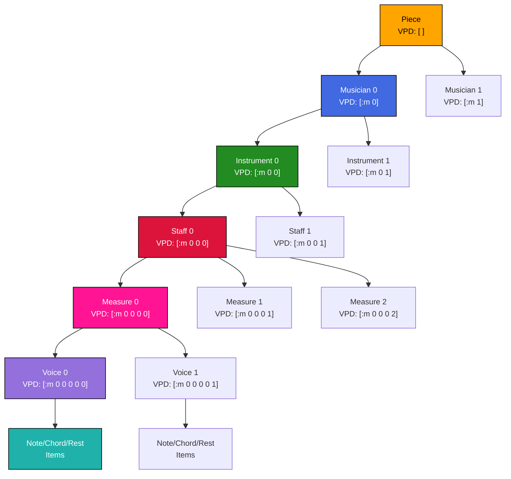
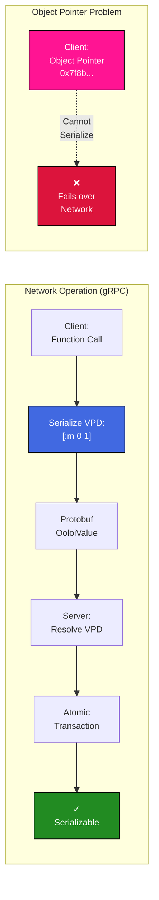
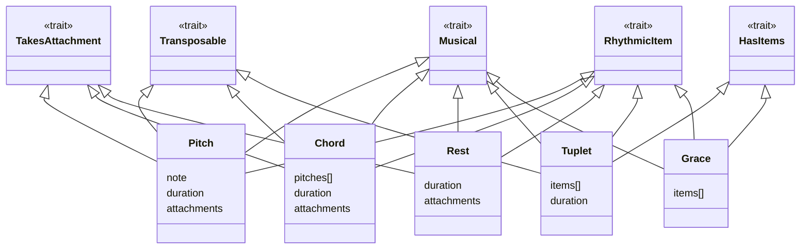
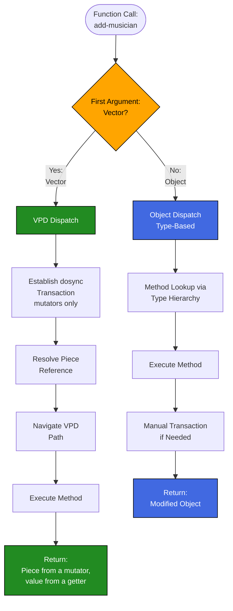

# Polymorphic API Guide: Talking to Ooloi

## Table of Contents

- [The Proof of the Pudding](#the-proof-of-the-pudding)
- [One Verb, Every Level](#one-verb-every-level)
- [Understanding the Mechanics](#understanding-the-mechanics)
- [Understanding Polymorphism in Ooloi](#understanding-polymorphism-in-ooloi)
  - [The Piece Reference Contract](#the-piece-reference-contract)
- [API Convenience: Why Use VPD Operations?](#api-convenience-why-use-vpd-operations)
  - [What You Get for Free with VPD Operations](#what-you-get-for-free-with-vpd-operations)
  - [When You Do Want STM: Easy Composition](#when-you-do-want-stm-easy-composition)
  - [Remote Atomic Operations: `SRV/atomic`](#remote-atomic-operations-srvatomic)
    - [Undo: one step per batch](#undo-one-step-per-batch)
    - [Composing on the backend](#composing-on-the-backend)
- [Type System Foundations](#type-system-foundations)
- [The Canonical Example: VPD vs Object Dispatch](#the-canonical-example-vpd-vs-object-dispatch)
- [Basic Polymorphic Operations](#basic-polymorphic-operations)
- [Cross-References](#cross-references)
- [Non-VPD Singleton API Functions](#non-vpd-singleton-api-functions)
- [Backend Component Broadcasting via the gRPC Server](#backend-component-broadcasting-via-the-grpc-server)
- [Summary](#summary)
- [Related Documentation](#related-documentation)

## The Proof of the Pudding

Most musical software forces musicians to adapt to developer abstractions. Ooloi's API lets you think musically. Here's building "Twinkle, Twinkle Little Star" from scratch:

```clojure
(require '[ooloi.shared.api :as api])

(dosync
  (let [;; Create piece with musical context
        piece (api/create-piece :title "Twinkle, Twinkle Little Star")
        c-major (api/create-key-signature :mode :major :tonic "C")
        four-four (api/create-time-signature :descriptor "4/4")
        piece (api/set-key-signature [] piece 0 c-major)
        piece (api/set-time-signature [] piece 0 four-four)
        piece (api/set-tempo [] piece 0 {:bpm 120 :beat-unit 1/4})

        ;; Add musician with instrument
        soprano (api/create-musician :name "Soprano")
        piece (api/add-musician [] piece soprano)

        voice-inst (api/create-instrument :name "Voice")
        piece (api/add-instrument [:m 0] piece voice-inst)

        ;; Add staff with treble clef
        piece (api/add-staff [:m 0 0] piece (api/create-staff :name "Soprano" :clefs {:sounding {:default-clef :treble} :written {:default-clef :treble}}))

        ;; Add two measures to soprano staff
        piece (api/add-measure [:m 0 0 0] piece (api/create-measure))
        piece (api/add-measure [:m 0 0 0] piece (api/create-measure))

        ;; Add voices to soprano measures
        piece (api/add-voice [:m 0 0 0 0] piece (api/create-voice))
        piece (api/add-voice [:m 0 0 0 1] piece (api/create-voice))

        ;; First measure: "Twin-kle twin-kle" (4 quarter notes)
        piece (api/add-item [:m 0 0 0 0 0] piece (api/create-pitch :note "C4" :duration 1/4))
        piece (api/add-item [:m 0 0 0 0 0] piece (api/create-pitch :note "C4" :duration 1/4))
        piece (api/add-item [:m 0 0 0 0 0] piece (api/create-pitch :note "G4" :duration 1/4))
        piece (api/add-item [:m 0 0 0 0 0] piece (api/create-pitch :note "G4" :duration 1/4))

        ;; Second measure: "lit-tle star" (2 quarters + 1 half)
        piece (api/add-item [:m 0 0 0 1 0] piece (api/create-pitch :note "A4" :duration 1/4))
        piece (api/add-item [:m 0 0 0 1 0] piece (api/create-pitch :note "A4" :duration 1/4))
        piece (api/add-item [:m 0 0 0 1 0] piece (api/create-pitch :note "G4" :duration 1/2))

        ;; Add slur across the entire phrase (first note to last note)
        piece (api/add-attachment [:m 0 0 0 0 0 :items 0] piece :slur [:m 0 0 0 1 0 :items 2])]

    piece))  ; Transaction ensures all operations succeed atomically
```

Notice the vocabulary: `add-musician`, `add-staff`, `add-item`, `add-attachment :slur`. The code reads like musical instructions. The VPD paths like `[:m 0 0 0 0 0]` navigate the hierarchy: musician → instrument → staff → measure → voice → items. The `dosync` ensures all operations succeed or none do - atomic piece construction.

This same pattern - create structures, set properties, add items hierarchically - applies to anything building musical content: MusicXML importers, notation software plugins, algorithmic composition tools.

## One Verb, Every Level

The power: same operation works at any hierarchy depth. Traditional APIs require different functions for each level:

```clojure
;; Traditional approach
(add-musician-to-piece piece musician)
(add-instrument-to-musician musician instrument)
(add-staff-to-instrument instrument staff)
(add-voice-to-measure measure voice)

;; Ooloi: ONE function works at ANY level
(api/add-musician [] piece-id musician)
(api/add-instrument [:m 0] piece-id instrument)
(api/add-staff [:m 0 0] piece-id staff)
(api/add-measure [:m 0 0 0] piece-id measure)
```

Same verb, different depths:

```clojure
;; Piece level
(api/add-musician    []              piece-id musician)
(api/set-tempo       []              piece-id 0 tempo)

;; Musician level
(api/add-instrument  [:m 0]          piece-id instrument)
(api/set-name        [:m 0]          piece-id "Violin I")

;; Instrument level
(api/add-staff       [:m 0 0]        piece-id staff)

;; Staff level
(api/add-measure     [:m 0 0 0]      piece-id measure)
(api/set-clefs       [:m 0 0 0]      piece-id {:sounding {:default-clef :treble}
                                               :written  {:default-clef :treble}})

;; Measure level
(api/add-voice       [:m 0 0 0 0]    piece-id voice)

;; Voice level
(api/add-item        [:m 0 0 0 0 0]  piece-id note)

;; Pattern: api/add-* always means "add this thing to that place"
;; The VPD specifies "that place", the verb remains constant
```

The verb stays the same, only the VPD depth changes. This is the architectural benefit: learn one pattern, use it everywhere.

### The verb hides representation, too — not only depth

The pattern reaches further than depth: the same verb works even when the target's *internal representation* differs from what the verb implies. A **Layout** — a score or a part — does not contain Musicians. It holds `:musician-uuids`, a flat vector of musician *references* into the piece's authoritative musician list (the score/part model, [ADR-0053](../ADRs/0053-Piece-Window-and-Piece-Preferences.md)). Yet you assign musicians to a layout, reorder them, and remove them with the ordinary verbs:

```clojure
(api/add-musician     [:l 0] piece-id musician)      ; records the musician's reference in layout 0
(api/reorder-musician [:l 0] piece-id ids target)    ; reorders that layout's references
(api/remove-musician  [:l 0] piece-id idx)           ; drops the reference from THAT layout — the musician stays in the piece
(api/remove-musician  []     piece-id idx)           ; deletes the musician from the piece — pruned from EVERY layout that listed it
```

You write `add-musician` and mean "put this musician in that layout"; that the layout stores a *reference*, not the musician, never surfaces. Removal has two scopes and the one verb serves both, keyed by the target: remove a musician from a *layout* and only that score or part loses it; delete the musician from the *piece* and referential integrity additionally prunes its reference from every layout that listed it. In each case an `:around` on the generic operation recognises the target and does the right maintenance — a musician also appears at most once in a layout, so a duplicate add is simply a no-op. That `:around` must ride the **VPD form** — the shape clients and the frontend use — not only the object form: the change funnel applies the VPD op directly and does not dispatch the object method (ADR-0052 §2, the object form is out of band), so an object-form-only `:around` silently skips every client and is caught only by a client-path test, never by an object-form unit test. Each maintenance obligation is wired as two `:around` twins, object-form and VPD-form (ADR-0053 §4). The API user — **and backend code, which calls the same `api`/`SRV` verbs** — never learns the representation differs, and cannot accidentally corrupt it. The polymorphism absorbs not just the *level* but the *shape*: one verb, every level, and — where the model demands a different internal form — every representation.

**The whole verb family, not just these three.** The redirect is not special to `add`/`reorder`/`remove` — *every* musician verb works on a layout target, each expressed as an operation on the layout's references:

| On a layout `[:l n]` | Effect on `:musician-uuids` |
|---|---|
| `add-musician … M` | append `(:id M)` (idempotent — a musician appears at most once) |
| `remove-musician … idx` | drop the idx-th reference; the musician stays in the piece |
| `reorder-musician … ids target` | id-based block reorder of the references |
| `get-musician … idx` | resolve the idx-th reference → the referenced `Musician` |
| `get-musicians …` | resolve every reference → the `Musician`s, in the layout's order |
| `set-musician … idx M` | set the idx-th reference `= (:id M)` |
| `set-musicians … Ms` | set the whole vector `= (mapv :id Ms)` |
| `move-musician … from to` | index-based reposition of one reference |
| `copy-musician … src to` | **refused (throws)** — a layout lists each musician at most once, so a reference cannot be duplicated |

Reads return `Musician` records — resolved from the piece, in the *layout's* order, which need not match the piece's `:musicians` order. **`copy-musician` on a layout is refused — it throws.** A layout references each musician at most once (uniqueness — `add-musician` is idempotent, so you cannot list one twice), so duplicating a reference is forbidden; and there is no `individuate` to rescue it, because a `[:l n idx]` VPD cannot descend into a musician. `copy` is the one musician verb that does not extend to a layout. To place a *distinct* copy of a musician in a layout, clone it at the piece — `copy-musician []` clones (a structural copy is a fresh-id clone) — and reference the clone with `add-musician [:l n]`.

**Two layers — never conflate them.** Two families share the word "musician", and they are **not** the same operations under two names:

- **`:musician-uuids` and its internal accessors** — `get-`/`set-musician-uuid`, `get-`/`set-musician-uuids`, `add-`/`remove-musician-uuid`. They carry `:vpd-category` (for VPD integration) but **deliberately no `:api`**, so they are **off the api/SRV surface entirely** — the backend's private primitives for editing the reference vector.
- **The public `*-musician` verbs** — the api/SRV surface, and on a layout target the *only* way to touch its musicians. The backend `:around` redirect **maintains `:musician-uuids` on the caller's behalf**, through the reference-maintenance family in `ooloi.shared.traits.structural`, which in turn uses those internal accessors.

> **As a caller, you will never call a `*-musician-uuid` operation — ever.** Not from the frontend, not over `SRV/`, not from a script, a plugin, or a test's client path. `get-musician-uuid`, `set-musician-uuids`, `add-musician-uuid` and their kin have **no `:api`**, so they are not exported to `api`/`SRV` at all — they are invisible to you. You never read or write `:musician-uuids` directly; the frontend sees the slot only as a projected field of `get-piece-structure`. If you catch yourself reaching for a `*-musician-uuid` name, you are one layer too low: the operation you want is the plain `*-musician` verb on a `[:l n]` target — `get-musicians [:l 0]`, never `get-musician-uuids`; `set-musicians [:l 0]`, never `set-musician-uuids` — and the backend maintains the vector for you.

So `set-musician-uuids` (internal primitive) and `set-musicians [:l n]` (public verb) are **different things at different layers**: the public verb is what a caller writes; it *happens* to maintain the vector by calling the internal primitive underneath. A caller uses the public verb and never learns the internal one exists.

**Why the internal vector declares `:no-move :no-copy`.** The reference vector is defined `(defvector Layout :musician-uuid :no-move true :no-copy true)` — and, lacking `:has-id`, generates no `reorder-musician-uuid` either. This says **nothing** about whether a layout supports move or reorder — it plainly does, through the public verbs above. It says only that the redirects maintain the vector through **whole-vector `set-musician-uuids`**: each reference-maintenance helper computes the new vector and writes it in one call, so per-item `move`/`reorder` primitives *on the internal vector* are never needed. Read `:no-move` as "the internal vector has no per-item mover of its own", never as "a layout cannot be moved-within". `move-musician [:l n]` is wired exactly like `add`/`remove`/`reorder`. `copy-musician [:l n]` is a different case entirely: it is **refused** — it throws — because duplicating a reference violates a layout's at-most-once invariant, not because the internal vector lacks a copier.

### The item can be a reference, too — a VPD as the thing to add

The same reach extends to the *argument*. An `add-<elem>` normally takes an element in hand — a value you built or hold — and inserts it:

```clojure
(api/add-instrument [:m 1] piece-id an-instrument)   ; add this instrument value to musician 1
```

But the item may itself be a **VPD** referencing an element that already lives in the piece. When it is, the operation resolves that VPD against the same piece, server-side, and adds the *referenced* element **by reference**:

```clojure
(api/add-instrument [:m 1] piece-id [:m 0 0])   ; add musician 0's first instrument to musician 1
```

The element's content is shared, never re-created; nothing but the VPD crosses the wire. This is the mechanism behind Ooloi's cross-container clones. The frontend holds only a content-free projection of the piece — paths and ids, no objects — so to copy an existing instrument into a *different* musician it sends the source's VPD, and `add-instrument` places the referenced instrument into the destination.

But the add alone is not yet a clone: the copy still carries the source's structural ids. A real clone is the add **and** an `individuate` — composed in one `SRV/atomic` transaction so both land together, and no observer ever sees the un-individuated intermediate:

```clojure
(SRV/atomic
  [{:method-name :add-instrument :vpd [:m 1]   :piece-id piece-id :parameters [[:m 0 0]]}  ; copy by reference into musician 1
   {:method-name :individuate    :vpd [:m 1 0] :piece-id piece-id :parameters []}])         ; re-id that copy → an independent clone
```

`individuate` re-ids the just-added copy at its landing VPD so it shares no identity with the source ([ADR-0051](../ADRs/0051-Filesystem-Operations-Real-and-Virtual.md)). Structural sharing plus copy-on-write means the shared content costs nothing until an edit lands on one copy.

The discriminator is `vpd?`: a vector shaped like a VPD (empty, or prefixed `:m`/`:l`/`:musicians`/`:layouts`) is a reference to resolve; anything else — a record, a keyword — is an element in hand, added as-is. Because every `add-<elem>` and `add-item` funnels through the same VPD-form insert, this holds for the whole family, at every level, with no per-operation wiring.

There is deliberately **no** "reset content" flag on the add. Whether the copy keeps the source's content or starts empty is an orthogonal decision, made afterwards with an ordinary `set-<elem>` on the copy — not a parameter that doubles the operation's contract.

**Within a container, `copy` clones directly — no `individuate` needed.** The cross-container clone above is `[add, individuate]` because `add` shares by reference. But `copy-<elem>` — duplicating within one container's own vector — clones a *structural* element outright: copying a Musician, Instrument, Staff, or Layout inserts a fresh-id copy that shares the source's substructure, so the `[copy, individuate]` pairing has collapsed to plain `copy` for the within-container case. (A non-structural `copy` — an item, voice, measure, or view — still inserts the source *by reference*, unchanged; only cloneable structural elements clone.) `individuate` remains only as the re-id step for the cross-container `add`-by-reference above.

## Understanding the Mechanics

The polymorphic mechanism: first argument determines operation mode.

```clojure
(require '[ooloi.shared.api :as api])

;; VPD-based operations
(api/add-musician [] piece-id new-musician)       ; VPD path, then piece reference
(api/get-measure [:m 0 0 0] piece-id 5)          ; Navigate with VPD

;; Direct object operations
(api/add-musician piece-object new-musician)      ; Direct object operation
(api/get-measure staff-object 5)                  ; Direct object access

;; Same operation name, different dispatch based on first argument type
;; VPD = [:path] → requires piece reference as second argument
;; Object = direct → operates on object directly

;; Type-based dispatch enables musical operations:
(api/get-duration pitch-item)     ; Dispatches to Pitch implementation
(api/get-duration chord-item)     ; Dispatches to Chord implementation
(api/get-duration rest-item)      ; Dispatches to Rest implementation
```

VPDs serialize across gRPC; object pointers don't. This dual-mode design enables both local efficiency and network transparency.

## Understanding Polymorphism in Ooloi

First argument determines operation mode:

```clojure
;; VPD-based operation
(api/add-musician [] piece-reference musician)

;; Direct object operation
(api/add-musician piece-object musician)

;; Same function name, different dispatch based on first argument type
```

### The Piece Reference Contract

**VPD operations accept three forms of piece reference as the second argument:**

```clojure
;; 1. Piece value (the data structure itself)
(api/add-musician [] piece musician)

;; 2. Piece ID (string identifier)
(api/add-musician [] "piece-uuid-123" musician)

;; 3. Piece STM ref (Clojure ref to piece)
(api/add-musician [] piece-ref musician)
```

**The rule:** The second argument to any VPD operation may be a piece value, a piece-id string, or a piece STM ref. All three forms work identically - the VPD system resolves them to the piece automatically.

**Why three forms?**
- **Piece value**: Direct local operations on piece data
- **Piece ID**: Network operations via gRPC, lookup from piece manager
- **Piece STM ref**: Concurrent modifications using Clojure's STM

Throughout this guide, you'll see examples mixing `piece` and `piece-id`. Both are valid - choose based on your context.

### Piece Hierarchy and VPD Navigation



Each level adds one index: `[]` → `[:m 0]` → `[:m 0 0]` → `[:m 0 0 0 0 0]`.

### gRPC Serialization Compatibility

Object pointers don't serialize over networks. VPDs do:

```clojure
;; VPD operations serialize perfectly over gRPC
{:operation :add-musician
 :vpd []
 :piece-id "symphony-uuid"  
 :data {...}}  ; ✓ All data, no pointers

;; Object pointer operations cannot serialize
{:operation :add-musician
 :object #<Object 0x7f8b...>  ; ✗ Pointer useless over network
 :data {...}}

;; CRUCIAL: gRPC calls always use VPD pattern → always wrapped in transactions
;; This ensures atomicity and consistency across network boundaries
(SRV/add-musician [] "piece-id" musician)  ; Automatic transaction on remote server
```

**Visual comparison: Why VPDs work over gRPC while object pointers fail:**



VPDs are values (serializable paths), not pointers (memory addresses).

### Automatic Transaction Management
```clojure
;; VPD first argument → automatic STM transaction establishment
(api/add-musician [] piece-id musician)         ; Automatic dosync + piece resolution + path navigation

;; Object first argument → direct operation (manual transaction management)  
(dosync                                          ; Manual transaction required
  (api/add-musician piece-object musician))     ; Direct object operation

;; VPD pattern provides convenience AND composability
(dosync
  (api/add-musician [] piece-id musician1)      ; All VPD operations participate
  (api/add-instrument [:m 0] piece-id instrument)  ; in the same transaction
  (api/set-tempo [] piece-id 0 new-tempo))      ; atomically
```

#### **How to Require the API**

Both `api/` and `core/` work the same way in backend and frontend:

```clojure
;; Standard: require core with :refer :all
(require '[ooloi.shared.models.core :refer :all])
(add-musician [] piece-id musician)
(set-tempo [] piece-id 0 tempo)
;; :refer :all on core gives you the entire engine plus predicates

;; Standard: require api with alias
(require '[ooloi.shared.api :as api])
(api/add-musician [] piece-id musician)
(api/set-tempo [] piece-id 0 tempo)
```

**Frontend usage:** `SRV/` provides remote operations to the server:

```clojure
(require '[ooloi.frontend.api.remote-api :as SRV])
(SRV/add-musician [] piece-id musician)
```

An `SRV/` call throws if it is made on the JavaFX application thread; dispatch it on a pool thread instead, with `cp/future`.

#### **`api/` and `SRV/` Are Not Interchangeable**

They are not two spellings of one thing. `api/` executes in the calling process, against real refs and values. `SRV/` is a set of wrappers — generated by compile-time introspection of `api` — that send the call to a backend as a gRPC request.

Because of that generation, every `SRV/` name also exists in `api`, which makes the two look substitutable when the backend happens to be in the same process. They are not. A shared *name* says nothing about whether the operation can execute with no request around it, and some cannot; see [Non-VPD Singleton API Functions](#non-vpd-singleton-api-functions).

Which to reach for follows from which side you are on:

- **Frontend code** uses `SRV/` for anything touching backend state. The piece lives only on the backend and the frontend is terminal, so there is nothing local to operate on.
- **Frontend code** uses `api/` to build values before sending them. `create-pitch`, `create-chord` and their kin are pure construction and involve no server.
- **Backend code** uses `api/`, and never `SRV/`. A backend does not call itself through a client.
- **Tests** follow the side they are standing on. A test driving the application as the user does reaches through `SRV/`; a test asserting what the backend holds calls `api/` in-process. The direction through the seam decides it, not which file the test happens to live in.

### The Three Pillars of Ooloi's Polymorphism

1. **First Argument Polymorphism**: Operations dispatch on VPD vs object
2. **Musical Type Polymorphism**: Operations dispatch based on musical element types (pitches, chords, rests)  
3. **Universal Hierarchy Access**: Same operation works at any level through VPD addressing

## API Convenience: Why Use VPD Operations?

Direct use of `alter`, `ref`, and low-level STM operations remains available, but the VPD API provides a higher-level abstraction that handles STM complexity automatically.

Compare:

```clojure
;; Low-level approach: Manual STM management (implementation focus)
;; Backend only: get-piece-ref is a plain function of the piece manager,
;; not part of api
(require '[ooloi.backend.ops.piece-manager :as pm])
(let [piece-ref (pm/get-piece-ref piece-id)]
  (dosync
    (alter piece-ref assoc-in [:musicians 0 :instruments 0 :staves 0 :measures 5] new-measure)))
;; Developer thinks about: refs, transactions, verbose paths, error handling
;; Note: assoc-in requires verbose form - compact VPDs don't work here
;; Note: an alter like this bypasses change detection, so no event is emitted

;; Platform approach: VPD operations (musical focus)
(api/set-measure [:m 0 0 0] piece-id 5 new-measure)
;; Developer thinks about: "set measure 5 in the first staff"
;; Compact VPDs work with Ooloi's API - another advantage of the platform approach

;; The VPD API abstracts away implementation complexity while providing musical clarity
```

### What You Get for Free with VPD Operations

- **Automatic transactions**: No need to manage `dosync` coordination yourself
- **gRPC compatibility**: Operations serialize across network boundaries seamlessly
- **Runtime validation**: Built-in validation and helpful error messages
- **Future-proofing**: Implementation can evolve without breaking your code
- **Consistency**: All operations follow identical patterns throughout the system

### When You Do Want STM: Easy Composition

```clojure
;; Compose multiple VPD operations in one transaction
(dosync
  (api/add-musician [] piece-id musician1)
  (api/add-instrument [:m 0] piece-id instrument)
  (api/set-tempo [] piece-id 0 new-tempo))
;; Atomic composition without managing STM complexity
```

Use `dosync` for atomic composition; VPD operations handle individual transactions automatically. A bare `dosync` gives atomicity and nothing more: each structural operation inside it still emits its own `:piece-structure-changed`, and it records no undo step. Composition that should reach clients as one change goes through `with-coalesced-structural-change` (`ooloi.shared.ops.change-detection`), as described under [Composing on the backend](#composing-on-the-backend).

### Remote Atomic Operations: `SRV/atomic`

When the frontend needs to execute multiple operations atomically on the server, use `SRV/atomic`:

```clojure
;; Frontend: Execute multiple operations atomically on the server
(SRV/atomic [{:method-name :set-name
              :vpd [:m 0]
              :piece-id "symphony-1"
              :parameters ["Violin I"]}
             {:method-name :set-key-signature
              :vpd []
              :piece-id "symphony-1"
              :parameters [0 (api/create-key-signature :mode :major :tonic "G")]}])
```

Key signatures are a piece-level change set, so `set-key-signature` addresses the piece (`[]`) and takes a position — here measure 0 — and a `KeySignature` record.

**When to use `SRV/atomic`:**
- **Remote atomic batches**: Frontend needs multiple operations to execute atomically on the server
- **Batch imports**: MusicXML/MIDI import operations that must succeed or fail atomically
- **Collaborative editing**: Multiple user operations that must be coordinated atomically
- **Undo/redo chains**: Complex operation sequences that form logical units

**Operation format:**
Each operation in the collection requires:
- `:method-name` (keyword) - The VPD API method to call (e.g., `:set-name`, `:add-measure`)
- `:vpd` (vector) - Vector Path Descriptor targeting the musical element
- `:piece-id` (string) - Identifier of the piece to modify  
- `:parameters` (vector) - Arguments to pass to the method

**ACID behavior:**
- **Atomicity**: All operations succeed together or all fail together
- **Consistency**: Piece remains in valid state throughout
- **Isolation**: Concurrent operations don't see partial state
- **Durability**: Not provided by the batch. A committed batch changes the piece in memory and marks it dirty; the piece reaches disk when it is saved (`save-piece`)

**Piece threading is implicit, through STM.** The batch does not thread a piece *value* from one operation to the next. All operations run in one transaction, and each is an ordinary VPD call that `alter`s the same piece STM ref; because they share the transaction, each operation reads the ref's in-transaction value — which already reflects every prior operation's change. So a batch can build on itself: `add-layout` appends a layout, and a following `add-musician [:l n]` in the same batch sees that layout and adds to it. Ordering within the batch is therefore significant, and the threading comes for free from the shared ref — you compose operations in the order they must apply, and STM threads the evolving piece for you.

This function integrates with Ooloi's STM-gRPC system to provide remote atomic batch execution for musical notation operations.

#### Undo: one step per batch

A mutation that arrives through `SRV/` records an undo step on the backend without the caller asking for one ([ADR-0015 §Automatic Capture and Deliberate Registration](../ADRs/0015-Undo-and-Redo.md#automatic-capture-and-deliberate-registration)).

- **A batch is one step.** However many operations an `SRV/atomic` batch holds, it records one undo entry. The two-argument form names it: the options map `{:undo-key k :undo-params p}` is stored with the entry, uninterpreted, for the undo menu to translate. A batch given no key is labelled `:undo.atomic`. The options change nothing about how the batch executes.
- **A lone call is one step**, labelled after its operation: `SRV/set-name` records `:undo.set-name`.
- **A write that changes nothing records nothing.** A VPD setter given the value already present returns the identical piece, and the boundary skips the entry on that identity test.
- **The batch's piece is its first operation's.** One batch records one entry against one piece, the one named by the first operation's `:piece-id`.
- **Capture happens only on the request path.** It is taken where the gRPC server executes a client's call. An `api/` call made in-process on the backend records nothing, and neither does `api/atomic` outside a request; backend code that wants an undo step registers it deliberately with `push-undo!` on the Backend Undo Manager.

```clojure
(SRV/atomic ops {:undo-key    :piece.undo.create-musician-from-instruments
                 :undo-params {:names ["Flute" "Oboe"]}})
```

A continuous gesture, such as a drag committed as the pointer moves, takes one transaction per update and is nonetheless one undo step, each later transaction amending the entry the first one pushed. That amendment is specified in [ADR-0015 §Continuous Gestures: One Undo Step](../ADRs/0015-Undo-and-Redo.md#continuous-gestures-one-undo-step); the capture described above is per call and per batch.

#### Composing on the backend

Backend code composing several operations does not go through a client, so it uses `api/`. A bare `dosync` around `api/` calls makes them atomic, but it is not a coalescing scope: each structural operation inside it emits its own `:piece-structure-changed`, and no undo step is recorded ([ADR-0052 §4](../ADRs/0052-Change-Detection-and-Event-Generation.md#4-exactly-one-event-per-outermost-transaction)). Composition that must reach subscribers as one change goes through `with-coalesced-structural-change`, which opens the transaction and collapses its structural changes to a single event. `api/atomic` on the backend runs its batch inside that same scope.

```clojure
(require '[ooloi.shared.ops.change-detection :as cd])

(cd/with-coalesced-structural-change
  (api/set-name [:m 0] piece-id "Violin I")
  (api/add-instrument [:m 0] piece-id instrument))
```

### Platform Abstraction: What the API Brings vs. How It Does It

Ooloi's API operates as a platform by hiding implementation complexity while exposing musical capability:

**What the API Brings (Musical Focus):**
- Operations that mirror musical thinking: `add-musician`, `(make-transposer :down :perfect :fifth)`, `set-tempo`
- Universal hierarchy navigation: same functions work at any structural level
- Type-safe musical reasoning: `pitch?`, `rhythmic-item?`, `transposable?`
- Automatic temporal coordination through timewalk
- Seamless local/remote operation compatibility

**What the API Hides (Implementation Details):**
- Complex metadata-driven method dispatch with ten-category system
- STM transaction coordination and conflict resolution
- VPD-to-object resolution and path validation
- Network serialization and gRPC protocol handling
- Memory optimization through lazy settings and structural sharing

**Example of Platform Abstraction Success:**
```clojure
;; Musical intent: "Add a forte marking to the third note of measure 5"
(add-attachment [:m 0 0 0 4 0 :items 2] piece-id (create-dynamic :name "f"))

;; Hidden complexity: VPD resolution, STM transaction, type validation,
;; attachment lifecycle, piece modification, change propagation, network sync
```

This demonstrates how domain expertise can translate directly to programming capability.

**For more advanced patterns, see [Advanced Concurrency Patterns](ADVANCED_CONCURRENCY_PATTERNS.md#-critical-development-principle-never-use-alter).**

## Type System Foundations

### Musical Traits and What They Mean

Ooloi organizes musical elements using **traits** - capabilities that determine what operations work with each type. Understanding these traits helps you know which API operations are available for each musical element.

**The five core traits:**

| Trait | Meaning | Example Operations |
|-------|---------|-------------------|
| **Musical** | Basic musical element | All core musical operations |
| **RhythmicItem** | Has duration | `get-duration`, `set-duration` |
| **Transposable** | Can change pitch | `transposable?`; note strings are transposed with `make-transposer` |
| **TakesAttachment** | Can have attachments | `add-attachment` (slurs, dynamics) |
| **HasItems** | Contains other elements | `add-item`, `get-items` |

**Musical Type Capability Matrix:**

```clojure
;;                    Musical  Rhythmic  Transposable  TakesAttachment  HasItems
;; Pitch              ✓        ✓         ✓             ✓                ✗
;; Chord              ✓        ✓         ✓             ✓                ✗
;; Rest               ✓        ✓         ✗             ✓                ✗
;; Tuplet             ✓        ✓         ✓             ✗                ✓
;; Tremolando         ✓        ✓         ✓             ✗                ✓
;; Grace              ✓        ✓         ✗             ✗                ✓
```

**Key insights:**
- **Pitch** has duration, can be transposed, and can have attachments (slurs, dynamics)
- **Rest** has duration and can have attachments, but cannot be transposed (you can't transpose silence)
- **Tuplet** contains other items and can be transposed as a group
- **Chord** has all the same capabilities as Pitch (duration, transposable, takes attachments)
- **Grace** (a group of grace notes) contains other items and has duration, but is neither transposable as a group nor a target for attachments

**Visual representation:**



### Using Traits in Your Code

Ooloi provides predicate functions to filter elements by their capabilities:

```clojure
;; Filter by trait using predicate functions
(filter rhythmic-item? musical-elements)      ; All elements with duration
(filter transposable? musical-elements)       ; Elements that can be transposed
(filter takes-attachment? musical-elements)   ; Elements that can have slurs, dynamics

;; Transposition works on note strings. make-transposer, in
;; ooloi.shared.ops.pitches, returns a function from pitch string to pitch string:
(require '[ooloi.shared.ops.pitches :refer [make-transposer]])
(def up-a-major-third (make-transposer :up :major :third))
(up-a-major-third "C4")                   ; => "E4"

;; Practical example: transpose the pitches among mixed elements
(defn transpose-pitches [elements transposer]
  "Transpose the note of every Pitch; leave everything else as it is."
  (map #(if (pitch? %)
          (set-note % (transposer (get-note %)))
          %)
       elements))

(transpose-pitches [pitch1 chord1 rest1 tuplet1] up-a-major-third)
;; => pitch1 transposed; chord1, rest1, tuplet1 unchanged
```

`transposable?` says that an element has pitch content (a pitch, a chord, a tuplet or a tremolando), not that an operation exists to transpose it whole; a chord's pitches are transposed one by one, like any other pitch.

This trait system determines which polymorphic operations work with each musical element type.

## The Canonical Example: VPD vs Object Dispatch

### The First Argument Pattern

> **Dispatch Resolution Decision Tree**:



The **VPD vs object dispatch** is the foundation of Ooloi's polymorphic architecture:

```clojure
;; THE POLYMORPHIC MECHANISM: Same function name, different dispatch

;; Object-based dispatch (object first argument) — written in the model
;; namespace. This one line in ooloi.shared.models.musical.piece defines
;; get-/set-musician, get-/set-musicians, add-, remove-, move- and
;; copy-musician, and (because of :has-id) reorder-musician, for a Piece:
(xs/defvector Piece :musician :has-id true)

;; VPD-based dispatch (vector first argument) — generated in
;; ooloi.shared.models.core from add-musician's :vpd-category. What the
;; generating macro emits for add-musician:
(m/defmethod add-musician clojure.lang.PersistentVector
  ([vpd piece-or-id-or-ref new-item]
   (vpd-transact la-ops/vpd-add-vector-item vpd piece-or-id-or-ref :musicians [new-item]))
  ([vpd piece-or-id-or-ref new-item position]
   (vpd-transact la-ops/vpd-add-vector-item vpd piece-or-id-or-ref :musicians [new-item position])))

;; vpd-transact resolves the piece reference to its STM ref
;; (i/resolve-into-piece-ref), opens the dosync, alters the piece at the VPD,
;; hands before and after to change detection, and returns the new piece.

;; Same function name → different implementations based on first argument type
```

**Location**: VPD operations generated automatically by macro system. Interfaces defined in `shared/interfaces.clj`, implementations in the model namespaces under `shared/models/`, interned through `shared/models/core.clj`

### Why This Pattern is Important

```clojure
;; ONE FUNCTION WORKS AT EVERY LEVEL WHERE THE DATA LIVES:

;; Key signatures belong to the piece
(api/set-key-signature [] piece-id 0 c-major)

;; An instrument or a staff carries local overrides of them
(api/set-key-signature-override [:m 0 0]   piece-id 0 d-major)   ; Instrument 0 of musician 0
(api/set-key-signature-override [:m 0 0 0] piece-id 0 f-major)   ; Its first staff

;; The same verb, set-key-signature-override, at two depths
;; Traditional APIs would need different functions for each level
```

The piece holds the key signatures; an instrument and a staff each hold a sparse change set of overrides, and the effective key at a position is the first one found from staff to instrument to piece. A musician holds neither.

### Automatic Transaction Management

```clojure
;; VPD pattern automatically handles STM coordination:
(api/add-musician [] piece-id musician1)              ; Automatic dosync
(api/add-instrument [:m 0] piece-id inst)     ; Automatic dosync  
(api/set-tempo [] piece-id 0 new-tempo)               ; Automatic dosync

;; Multiple VPD operations compose in outer transaction:
(dosync
  (api/add-musician [] piece-id musician1)            ; All participate in
  (api/add-instrument [:m 0] piece-id inst)   ; same atomic transaction
  (api/set-tempo [] piece-id 0 new-tempo))            ; automatically
```

### gRPC Network Compatibility

```clojure
;; VPD operations serialize perfectly for remote calls:
{:operation "add-musician"
 :vpd []                          ; ✓ Pure data - serializes
 :piece-id "symphony-uuid"        ; ✓ String ID - serializes  
 :musician {...}}                 ; ✓ Data map - serializes

;; Object operations cannot work over network:
{:operation "add-musician"  
 :piece #<Object 0x7f8b...>}      ; ✗ Object pointer - cannot serialize

;; Result: All gRPC calls use VPD pattern → automatic transactions across network
```

## Basic Polymorphic Operations

### Understanding Return Values

VPD mutators ALWAYS return the piece; VPD getters return the value they read:

```clojure
;; VPD mutators guarantee piece return
(let [piece (api/add-musician [] piece-id musician)                 ; Returns piece
      piece (api/set-tempo [] piece 0 {:bpm 120 :beat-unit 1/4})]   ; Returns piece
  piece)  ; Guaranteed to be the updated piece

;; VPD getters return the value at the address
(api/get-name [:m 0] piece)   ; => "Violin I"
```

**Object operations return what was changed:**

```clojure
;; Object form returns the modified object
(let [musician (api/add-instrument musician instrument)]  ; Returns modified musician (not piece)
      instrument (api/add-staff instrument staff)]        ; Returns modified instrument (not piece)
  ...)

;; Exception: Settings operations that modify the piece
(let [piece (api/set-tempo piece 0 {:bpm 120})]         ; Returns piece (tempo stored ON piece)
  piece)  ; Works because tempo is a piece-level setting
```

**Why this matters:**

| Form | Returns | Use Case | Threading |
|------|---------|----------|-----------|
| **VPD mutator** | Always piece | Modifying piece structure | ✓ Safe with let rebinding |
| **VPD getter** | The value read | Reading from the piece | Not a piece |
| **Object** | Modified object | Direct object manipulation | ⚠️ May not return piece |

**Golden Rule:** When threading multiple piece modifications, **always use VPD form** for guaranteed piece return.

### Duration Operations Across Types

```clojure
;; Duration operations work polymorphically across musical elements:
(require '[ooloi.shared.api :as api])

;; Different types, same operation
(api/get-duration pitch-object)     ; => 1/4 (quarter note)
(api/get-duration chord-object)     ; => 1/2 (half note)  
(api/get-duration rest-object)      ; => 1/8 (eighth rest)

;; Setting duration works the same way
(api/set-duration pitch-object 1/16)   ; Creates sixteenth note
(api/set-duration chord-object 1)      ; Creates whole note chord
(api/set-duration rest-object 1/2)     ; Creates half rest
```

### Expressive Attachment API

Compare adding a slur:

```clojure
;; Traditional approach: Manual ID management
(def slur (new Slur()))
(.setStartNote slur start-note)
(.setEndNote slur end-note)
(.setStartId slur (getId start-note))
(.setEndId slur (getId end-note))
(.addToScore score slur)

;; Ooloi: Musical intent
(add-attachment start-vpd piece "slur" end-vpd)
```

**Musical Expression Through Direct Terminology:**

```clojure
;; VPD operations – navigation + action in one expression
(add-attachment [:m 0 0 0 2 0 :items 0] piece "staccato")       ; "Make the first note staccato"
(add-attachment [:m 0 0 0 2 0 :items 1] piece "f")              ; "Make the second note forte"
(add-attachment [:m 0 0 0 2 0 :items 2] piece "marcato")        ; "Marcato on the third"
(add-attachment [:m 0 0 0 2 0 :items 3] piece "tenuto")         ; "Fourth note: tenuto"
(add-attachment [:m 0 0 0 2 0 :items 0] piece "slur"            ; "Slur from first note
                [:m 0 0 0 2 0 :items 5])                        ;  to sixth note"

;; Local operations – direct object manipulation takes an attachment record
(add-attachment pitch (create-articulation :name "staccato"))
(add-attachment chord (resolve-attachment "marcato"))   ; Shortcut resolved explicitly

;; Span attachments – start and end points clearly expressed
(add-attachment start-vpd piece "cresc" end-vpd)  ; "Crescendo from here to there"
(add-attachment start-vpd piece "8va" end-vpd)    ; "Play octave higher from here to there"
(add-attachment start-vpd piece "tie" end-vpd)    ; "Tie these two notes"
```

**Abstraction in Practice – Building Musical Phrases:**

```clojure
;; The developer focuses on musical intent (using VPD form with let rebinding)
(let [piece (add-attachment [:m 0 0 0 0 0 :items 0] piece "p")              ; Piano dynamic
      piece (add-attachment [:m 0 0 0 0 0 :items 0] piece "slur"            ; Opening slur
                            [:m 0 0 0 0 0 :items 3])
      piece (add-attachment [:m 0 0 0 0 0 :items 2] piece "marcato")        ; Marcato on third note
      piece (add-attachment [:m 0 0 0 0 0 :items 4] piece "cresc"           ; Crescendo to end
                            [:m 0 0 0 0 0 :items 7])
      piece (add-attachment [:m 0 0 0 0 0 :items 7] piece "f")]             ; Forte at climax
  piece)

;; No endpoint IDs, no graph wiring, no object lifecycle management
;; The API handles all implementation mechanics automatically
```

**Flexible Input Forms** (keywords, symbols, or strings):

```clojure
;; All three forms work identically – use what reads best in context
(add-attachment vpd piece "staccato")   ; String – clear and explicit
(add-attachment vpd piece :f)           ; Keyword – concise for short markings
(add-attachment vpd piece 'tenuto)      ; Symbol – alternative style
```

Shortcuts are resolved by the VPD form of `add-attachment` (and `set-attachment`), which hands them to `resolve-attachment` before anything is added; an unregistered name throws `Unknown attachment shortcut`. The object form adds whatever it is given, so it takes an attachment record — from a constructor, or from `resolve-attachment` called directly.

**Available Musical Vocabulary:**

The shortcuts registered in `ooloi.shared.models.core`:
- **Articulations**: `staccato` (`stacc`), `staccatissimo` (`staccmo`), `tenuto` (`ten`), `marcato` (`marc`), `marcatissimo` (`marcmo`)
- **Dynamics**: `ffff` through `pppp`, and sforzando combinations from `sf`, `sfz` and `fz` up to `sffffzpppp`, with or without a following piano dynamic (`sfp`, `sfzpp`, …)
- **Hairpins**: `<` (`crescendo`, `cresc`), `>` (`diminuendo`, `dim`), `<>` (`cresc-dim`)
- **Span markings**: `slur`, `tie`, `glissando` (`gliss`)
- **Octave shifts**: `15ma`, `8va`, `8vb`, `15mb`

For markings not covered by shortcuts, use constructor functions directly:

```clojure
(def accent (create-articulation :name "accent"))
(add-attachment pitch accent)
```

### Attachment Operations with Type Constraints

```clojure
;; Attachments belong on elements that support them:
(api/add-attachment pitch-object staccato)    ; ✓ Pitch implements TakesAttachment
(api/add-attachment chord-object forte)       ; ✓ Chord implements TakesAttachment
(api/add-attachment rest-object tenuto)       ; ✓ Rest implements TakesAttachment
;; (staccato, forte and tenuto are attachment records, e.g.
;;  (api/create-dynamic :name "f"))

;; Type-safe filtering before operations
(defn add-marking-to-compatible [elements marking]
  "Add marking only to elements that can take attachments."
  (->> elements
       (filter takes-attachment?)                          ; Type-safe filtering
       (map #(api/add-attachment % marking))))             ; Safe operation

;; Usage with mixed elements
(def mixed [pitch1 chord1 rest1 tuplet1])
(add-marking-to-compatible mixed staccato)  ; Only pitch1, chord1, rest1 get marking
```

Filter before adding. The VPD form addresses whatever its VPD names and does not check the trait: given the VPD of a voice rather than of an item, it adds the attachment to the voice's record.

### Collection Operations with HasItems

```clojure
;; HasItems trait enables collection operations:
(api/get-items tuplet-object)        ; Returns vector of items in tuplet (can be anything, nest arbitrarily)
(api/add-item tuplet-object pitch)   ; Adds pitch to tuplet
(api/get-item tuplet-object 2)       ; Gets third item in tuplet

;; A measure holds voices, and a voice holds the items:
(api/get-voices measure-object)      ; Returns vector of voices
(api/add-voice measure-object voice) ; Adds a voice to the measure
(api/get-items voice-object)         ; Returns vector of items in the voice
(api/add-item voice-object chord)    ; Adds chord to the voice

;; Use standard predicate from core

(filter has-items? [pitch1 tuplet1 grace1])            ; => [tuplet1 grace1]
```

**Adding by reference:** in VPD form, the item argument may itself be a VPD referencing an element already in the piece; `add-item` / `add-<elem>` then resolves it server-side and adds the referenced element by reference. See [The item can be a reference, too](#the-item-can-be-a-reference-too--a-vpd-as-the-thing-to-add) above.

**Note:** For filtering specific musical element types like pitches and chords, use the [timewalker](TIMEWALKING_GUIDE.md) which provides powerful traversal and filtering capabilities.

### Reordering a Collection: `move-<elem>` vs `reorder-<elem>`

Two families reorder a vector, and they differ in how they address the items.

`move-<elem>` is **index-based**. It repositions a single item from one index to another, and works on any vector — including the id-less content vectors (measures, voices, items):

```clojure
;; Move the instrument at index 0 to the end of its musician
(api/move-instrument [:m 0] piece-id 0 -1)
```

`reorder-<elem>` is **identity-based**. It moves a whole (multi-)selection — named by the items' `:id`s — to a contiguous block after a target item, in one arrangement:

```clojure
;; Reorder musicians: move the block {id-a, id-b} to just after id-c
(api/reorder-musician [] piece-id [id-a id-b] id-c)   ; a nil target moves the block to the front
```

The reorder is computed as a single splice — remove the selected items, resolve the target position in what remains, then reinsert the selection there (`remaining ++ ordered`). Done as one splice, a multi-item reorder is contiguous by construction and needs no sequence of single moves (which would each have to account for the previous move shifting the next one's indices). Because it matches on `:id`, `reorder-<elem>` exists only for the id-bearing **Structural** entities — musicians, instruments, staves, layouts — while `move-<elem>` remains the index primitive for everything else.

A drag-and-drop reorder in the UI composes exactly one such call inside an [`SRV/atomic`](#remote-atomic-operations-srvatomic) batch: the client sends only the selected `:id`s and the target `:id` — never the items themselves — and the backend performs the arrangement server-side.

### No whole-piece transfer — you address into the piece

There is no `get-piece` and no `set-piece`: the piece never crosses the wire whole. This is a boundary, not a gap ([ADR-0040](../ADRs/0040-Single-Authority-State-Model.md) §*Operations as the Only Unit of Truth*) — the authoritative piece lives only on the backend, and the frontend never holds it whole. You work with it across `SRV/`:

```clojure
(require '[ooloi.frontend.api.remote-api :as SRV])

;; 1. Read structure — the content-free projection (titles, names, ids, the
;;    layout<->musician graph; no musical content), refetched on :piece-structure-changed.
(SRV/get-piece-structure [] piece-id)

;; 2. Read a value or an element — a VPD getter addresses it exactly.
(SRV/get-name       [:m 0]   piece-id)
(SRV/get-instrument [:m 0 0] piece-id)

;; 3. Edit — VPD mutators; compose a multi-op gesture into one transaction with SRV/atomic.
(SRV/set-name [:m 0] piece-id "Violin I")
(SRV/add-musician [] piece-id a-musician)
```

Element-level get/set is entirely normal — `get-instrument` / `set-instrument`, `get-staff` / `set-staff`, `get-name` / `set-name`. What has no operation is the *whole piece*.

Every call carries values across the wire with full fidelity — `OoloiValue` preserves Clojure types exactly ([ADR-0046](../ADRs/0046-Reference-Passing-In-Process-Transport.md), [ADR-0018](../ADRs/0018-API-gRPC-Interface-and-Events.md)) — so what you read is what the backend holds, and a value you submit lands identical. A whole-piece roundtrip (`get-piece` → edit locally → `set-piece`) would in fact work on that fidelity, and it is the sharpest proof of it — but the pair is deliberately withheld, to underline that the piece lives on the backend and changes only through operations against it ([ADR-0040](../ADRs/0040-Single-Authority-State-Model.md)). The backend's undo/redo also leans on that absence — every piece mutation is a categorised VPD operation, with nothing uncategorised to escape capture. The boundary is a choice, not a technical limit: reintroducing the pair, were it wanted, is straightforward.

## Cross-References

### **Implementation Details**
- **Type system implementation**: See `shared/src/main/clojure/ooloi/shared/hierarchy.clj` for complete type definitions
- **Shared interfaces**: See `shared/src/main/clojure/ooloi/shared/interfaces.clj` for multimethod definitions
- **Backend implementations**: See `backend/src/main/clojure/ooloi/backend/ops/` for the backend's implementations of the shared protocols — piece resolution by piece-id and piece-manager operations (`piece_manager.clj`), atomic batches (`atomic_handler.clj`)

### **Related Guides**
- **VPD integration**: See [VPDs Guide](VPDs.md) for path-based operation patterns
- **Piece management**: See [Piece Manager Guide](PIECE_MANAGER_GUIDE.md) for `get-piece-ref` usage patterns
- **Musical traversal**: See [Timewalking Guide](TIMEWALKING_GUIDE.md) for type-aware traversal examples

### **Architectural Foundations**
- **Tree structure**: See [ADR-0010: Pure Trees](../ADRs/0010-Pure-Trees.md) for the hierarchical structure that VPD navigation operates on
- **VPD system**: See [ADR-0008: VPDs](../ADRs/0008-VPDs.md) for the architectural decision behind Vector Path Descriptors used throughout the polymorphic API
- **gRPC compatibility**: See [ADR-0002: gRPC](../ADRs/0002-gRPC.md) for why VPD serialization enables frontend-backend communication
- **Language foundations**: See [ADR-0000: Clojure](../ADRs/0000-Clojure.md) for the language choice enabling multimethod polymorphism

## Non-VPD Singleton API Functions

Not all `^{:api true}` functions navigate piece hierarchies. Some operate on singleton backend components — resources that exist once per server process rather than once per piece. The Instrument Library, for example, is a single shared collection; there is no VPD path because there is no piece to navigate.

These functions follow a distinct pattern from VPD operations.

### Declaration

In `interfaces.clj`, declare the function with `^{:api true}` but **without** `:vpd-category`. The dispatch function returns a fixed keyword (not derived from the first argument):

```clojure
(m/defmulti ^{:api true} get-instrument-library
  "Returns the current instrument library: {:version n :instruments [...]}"
  (fn [] :instrument-library))

(m/defmulti ^{:api true} set-instrument-library
  "Replaces the instrument library under optimistic locking."
  (fn [expected-version new-instruments] :instrument-library))
```

No `:vpd-category` means the VPD wrapper machinery is not applied. No automatic `dosync`, no piece resolution. The function receives and returns exactly what you declare.

### Implementation

Implement in a `shared/ops/` namespace. Because shared code cannot require backend namespaces directly, the component is reached via `resolve` on the existing `*server-component*` dynamic var defined in the gRPC server. The component is read out of the server-component map:

```clojure
(m/defmethod i/undo-resource :undo-resource
  [resource-key]
  (let [server-component @(resolve 'ooloi.backend.grpc.server/*server-component*)
        component         (:undo-manager-component server-component)
        undo-fn           (resolve 'ooloi.backend.components.backend-undo-manager/undo!)]
    (undo-fn component resource-key)
    ...))
```

`*server-component*` is the gRPC server component map, bound per-request by `handle-execute-method` in `backend/grpc/server.clj`. Backend Integrant deps injected into the gRPC server — `:undo-manager-component`, `:instrument-library-component`, and any future singleton component — appear as keys on this map. Reach them by `(:my-component server-component)`.

> **🚨 Anti-pattern: per-component dynamic vars.** A singleton component is never given a `^:dynamic` var of its own (e.g. `*instrument-library-component*`). Each such var would have to be bound in the handler's `binding` block (`handle-execute-method`); missing it silently routes the component as `nil` and the request returns `{:result nil}` with no error visible to the caller. The `*server-component*` map already carries every dep — use it directly. The subscription operations in `event_subscription.clj` and the undo operation in `ops/undo.clj` are the canonical model.

### Frontend Usage

The frontend calls these functions identically to VPD operations — through the `SRV/*` namespace, with no protobuf changes:

```clojure
(require '[ooloi.frontend.api.remote-api :as SRV])

(SRV/get-instrument-library)
(SRV/set-instrument-library expected-version new-instruments)
```

### When to Use This Pattern

Use a non-VPD singleton API function when:

- The operation targets a singleton backend component (not a piece)
- There is no VPD path because there is no musical hierarchy to navigate
- The function needs to be accessible from the frontend via `SRV/*`

Use a VPD operation when the target lives inside a piece. Use a direct `ops/` function call (no `^{:api true}`) when the operation is internal to the backend and never called from the frontend.

### Singleton Operations Are Reachable Only Through `SRV/`

A singleton operation resolves its component from `*server-component*`, and that var is bound **per request**, by `handle-execute-method`. Outside a request it holds its root value, `nil`, so the component reads as `nil`, and the operation fails somewhere inside itself rather than at the call — `list-filesystem-roots` invoked directly dies several frames deep, dereferencing a nil connection registry, with nothing in the message to suggest a missing binding.

So a singleton operation is called through `SRV/` or not at all — from tests as much as from production, and no less when the backend is in the same process. This is the one place where the api-contains-everything intuition breaks. The name exists in `api` only because `SRV` is generated from `api`; the operation still has no way to reach its component without a request around it.

The filesystem family has a second reason, and it is semantic rather than mechanical. Its tokens are minted per client and held on that client's connection-registry entry, and under a collaborative session a host and a guest navigating what looks like the same hierarchy must resolve the same names to different places. The caller's identity is part of what the operation *means*, so there has to be a caller. See [ADR-0051](../ADRs/0051-Filesystem-Operations-Real-and-Virtual.md) for the token contract.

### Canonical Precedent

`subscribe-to-piece-events` and `unsubscribe-from-piece-events` in `shared/ops/event_subscription.clj` establish this pattern. Both are declared `^{:api true}` without `:vpd-category` in `interfaces.clj` and access `*server-component*` via `resolve`.

## Error Surfacing Contract: Response Data, Client-Side Throw

Every gRPC-accessible API function — VPD-based or singleton — returns through a uniform error contract. **Errors are values, not exceptions, on the wire — but they surface as exceptions at the SRV/* caller boundary.**

### Server side: errors as data

`handle-execute-method` in `backend/grpc/server.clj` catches `Throwable` from the invoked operation, records API-failure and error-category statistics, and returns a response map:

```clojure
;; Success
{:success true  :error ""                          :result <value>}

;; Failure
{:success false :error "Execution error: <msg>"    :result nil}

;; Method not found
{:success false :error "Method not found: <name>"  :result nil}
```

The error message is preserved verbatim in `:error`. The server does **not** rethrow — exceptions never cross the gRPC boundary as `Status/INTERNAL`, which would truncate or normalise the message.

### Client side: SRV/* throws on `:success false`

The auto-generated `SRV/*` wrapper in `frontend/api/remote_api.clj` checks the response:

```clojure
(if (false? (:success response))
  (throw (ex-info (str "SRV/" method-name " failed: " (:error response))
                  {:method method-name
                   :params compacted-params
                   :server-error (:error response)
                   :response response}))
  (:result response))
```

Callers get the result on success, or a thrown `ex-info` carrying the server's exact error message plus method/params context. **Silent nils are not possible** — a server-side failure becomes a loud exception at the caller's boundary, with full inspectable context.

### Why this shape (Pattern A, not server re-throw)

The alternative — having the server re-throw and letting gRPC propagate a `StatusRuntimeException` — is rejected because:

1. **Error message fidelity**: gRPC's `Status/INTERNAL` description gets truncated and normalised by the runtime. The response-shape `:error` string survives intact.
2. **Inspectable as data**: tests and callers that want to verify "this call failed with X error" can do so against a value (`response`), not by catching an exception type. Rich Hickey's "errors are values too" applies — non-local control flow (throwing) is reserved for the boundary, not for traversing layers.
3. **Stats integrity**: the server records failure stats and error categorisation *before* the response is built. Tests can verify those counters directly without needing to catch-then-assert.
4. **One contract, all paths**: the same `{:success :error :result}` envelope works for in-process transport (reference-marshalled), network transport (wire-marshalled), and the "Method not found" case where no exception occurred at all. Server re-throw would split paths.

### Test mock convention

Tests that mock `grpc-clients/execute-method` with Midje `provided` must return at least `{:result <value>}` to simulate success. A bare `{:result ...}` is treated as success (the `(false? (:success response))` check only throws on explicit `false`, not on missing `:success`). To simulate a server-side failure, mocks return `{:success false :error "<message>"}`.

## Backend Component Broadcasting via the gRPC Server

The `resolve` + `^:dynamic var` mechanism described in the previous section also appears in a second role: **backend components that need to call back into the gRPC server to broadcast events**. `backend/components/instrument_library.clj` uses it for `:instrument-library-changed`; `backend/components/backend_undo_manager.clj` uses it for `:undo-state-changed`.

The mechanism is identical to the shared→backend case — `(some-> (resolve 'ooloi.backend.grpc.server/*server-component*) deref)` followed by an invocation of `send-server-event` resolved the same way. The **reason** for using runtime resolution here is *not* the modularity constraint that motivates the shared→backend case (both files live in `backend/`, so static `:require` would be legal). The reason is **namespace-level decoupling**: the broadcasting component does not statically link the gRPC stack, allowing it to run in isolation (component tests, future deployment modes that omit gRPC) without forcing the gRPC machinery to be loaded.

The dynamic var is bound during `handle-execute-method`, so during any gRPC request the broadcast call reaches a real `*server-component*`. Outside a request (component-isolation tests, server-internal mutations), the var holds its root value, `nil`, and the broadcast no-ops, guarded by `when-let`.

### Alternatives Considered

The choice prefers consistency with the documented shared→backend pattern and namespace-level decoupling over compile-time linkage. Three alternatives are not adopted; they remain available should the trade-offs shift:

1. **Function injection at `grpc-server`'s `init-key`.** Each broadcasting component carries a `:broadcast-fn` slot. At its own startup, `grpc-server` plugs the real send function into each. Compile-time linkage; one explicit wiring step per broadcaster; mild post-init-mutation smell.
2. **Dedicated broadcaster component.** A small Integrant component holds the broadcast function. `grpc-server` injects the real function into it at startup. Every broadcaster declares the broadcaster as an Integrant dependency and calls a single `broadcast!` function. Scales uniformly to N broadcasters; introduces one new component whose only purpose is to hold a function reference.
3. **Atom-watch from `grpc-server`.** `grpc-server`, at its `init-key`, calls `add-watch` on the broadcasting component's state atom. The broadcasting component becomes pure data with no awareness of broadcasting; causation invisible at the call site; introduces a new project convention not used elsewhere.

### When to Revisit

The `resolve`+dynvar choice is appropriate while the number of backend broadcasters is small (two: the instrument library and the backend undo manager) and the namespace-decoupling benefit holds.

Revisit in favour of alternative (2) — the dedicated broadcaster component — if:

- The number of broadcasters grows past ~4 and tracking the implicit `*server-component*` dependency becomes hard
- A typo in a quoted symbol survives to runtime as a real bug
- The component-isolation argument stops mattering (every realistic deployment includes gRPC)

## Summary

> **Architectural Achievement**: Ooloi demonstrates how functional programming enables domain expertise to become the programming model - not the other way around.

Ooloi's polymorphic API represents type-driven architecture that achieves flexibility while maintaining safety and performance:

**Key insights:**
1. **Trait-based types** define which operations work with each musical element
2. **Dual-mode dispatch** provides VPD and object operation modes
3. **VPD operations** enable universal hierarchy access and automatic transactions
4. **Musical predicates** enable filtering and type-aware operations
5. **Consistent patterns** make the API predictable and easy to use

**Architectural advantages:**
- **Developer experience**: Simple, consistent APIs that match musical thinking
- **Type safety**: Trait system ensures operations only work with compatible elements
- **Network compatibility**: VPD operations serialize across gRPC automatically
- **Transaction guarantees**: Automatic atomicity for piece modifications
- **Maintainability**: Centralized type definitions and consistent operation patterns

This polymorphic foundation enables all the APIs demonstrated throughout Ooloi's other architectural guides. Understanding these patterns improves your ability to work with Ooloi's musical type system.

## Related Documentation

### Next Steps in Learning
- **[VPDs.md](VPDs.md)** - Deep dive into Vector Path Descriptors and addressing patterns
- **[PIECE_MANAGER_GUIDE.md](PIECE_MANAGER_GUIDE.md)** - STM-based storage operations using the type system
- **[TIMEWALKING_GUIDE.md](TIMEWALKING_GUIDE.md)** - Temporal traversal patterns leveraging polymorphic dispatch

### Advanced Applications
- **[FRONTEND_ARCHITECTURE_GUIDE.md](FRONTEND_ARCHITECTURE_GUIDE.md)** - How the frontend renders, caches, and interacts with typed musical structures
- **[GRPC_COMMUNICATION_AND_FLOW_CONTROL.md](GRPC_COMMUNICATION_AND_FLOW_CONTROL.md)** - How the type system enables seamless network serialization
- **[OOLOI_SERVER_ARCHITECTURAL_GUIDE.md](OOLOI_SERVER_ARCHITECTURAL_GUIDE.md)** - Server architecture built on these polymorphic foundations
- **[ADVANCED_CONCURRENCY_PATTERNS.md](ADVANCED_CONCURRENCY_PATTERNS.md)** - Complex STM coordination using type-driven operations